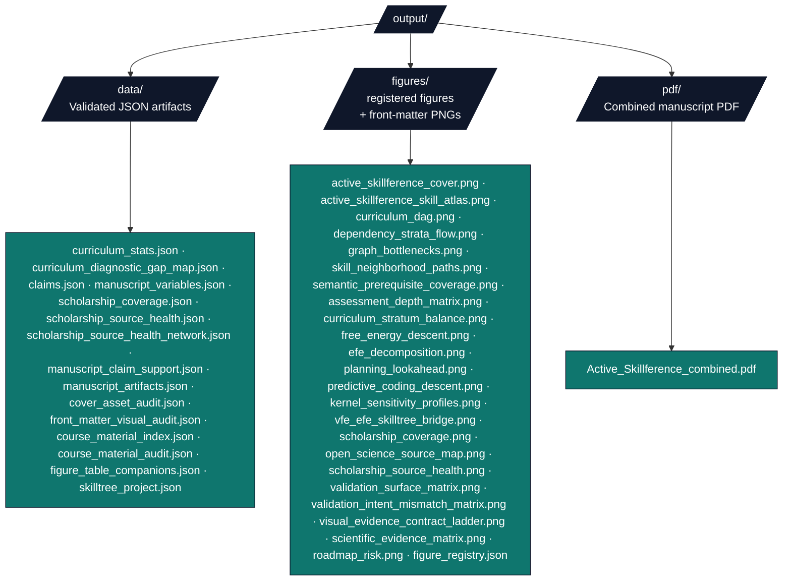

# Output Directory Conventions

The project-relative `output/` directory holds every generated artifact. This is a
**local-only** project, so there is no promoted monorepo `output/<project>/` copy — the
authoritative outputs live directly under `Active_Skillference/output/`.

## Directory purpose

`output/` is **disposable but regeneratable**. Every file is produced by a deterministic
script; none should be edited by hand. If a file is missing or stale, re-run the script
that produces it.

**Source of truth for every output:**

- `src/kernels/` + `src/kernels/examples.py` — the tested kernels and worked examples (the source of every claim).
- `src/curriculum/catalog_data/` + `src/curriculum/_ext_*.py` — the curriculum (subjects, skills, prerequisites, assessments).
- `src/curriculum/diagnostics.py` — graph bottleneck, long-chain, assessment-balance,
  and remediation-queue diagnostics derived from the validated curriculum.
- `src/provenance/` — the claim registry and the fail-closed provenance/lint gate.
- `src/scholarship/` + `data/scholarship_sources.yaml` — citation source-role coverage.
- `src/manuscript/` — generated figure registry, manuscript labels, and dashboard-artifact audit.
- `src/curriculum/materials/` + `data/course_material_sources.yaml` — generated local
  Learn records and pinned external source pointers.
- `src/skilltree/` + `src/figures/` — the SkillTree exporter and the figure renderers.

## Directory structure



The manuscript render also emits per-section Beamer slide PDFs and HTML under
`output/slides/` and `output/web/`; those are renderer by-products, not part of the
core curriculum/provenance contract. The generated `output/data/*.json` files, the
registered manuscript figures, the generated cover and page-two atlas PNGs, `output/figures/figure_registry.json`,
and the combined manuscript PDF are the authoritative
artifacts — inventoried with their producers in [`output_inventory.md`](output_inventory.md).
The figure registry is the chart-contract source of truth: it preserves source-row caption,
alt-text and semantic fields while adding `question`, `takeaway`, `data_sources`,
`data_grain`, `encoding`, `palette_policy`, `palette_roots`, `non_color_encoding`,
`static_read`, `mobile_read`, `failure_mode`, and optional `table_companion_id` for
manuscript/dashboard parity checks. Dense table-like figures resolve those ids through
`output/data/figure_table_companions.json`.

## Regeneration sequence

Run from the project root. Each script is a thin orchestrator over `src/`.

1. **Validate the curriculum DAG** — writes `output/data/curriculum_stats.json` and
   `output/data/curriculum_diagnostic_gap_map.json`.
   ```bash
   uv run python scripts/build_curriculum.py
   ```
2. **Run kernels** — registers claims, validates the curriculum, manuscript tokens, and
   scholarship matrix (fail-closed), and writes `output/data/claims.json`,
   `output/data/manuscript_variables.json`, `output/data/scholarship_coverage.json`,
   `output/data/scholarship_source_health.json`,
   `output/data/scholarship_source_health_network.json`,
   `output/data/scholarship_gap_report.json`,
   `output/data/manuscript_claim_support.json`,
   `output/data/curriculum_diagnostic_gap_map.json`, and the figures plus
   `output/figures/figure_registry.json`. It then writes
   `output/data/figure_table_companions.json` and
   `output/data/manuscript_artifacts.json` after checking registry, manuscript, readable
   nonblank PNGs, caption/alt-text specificity, semantic figure metadata, structured chart-contract fields, dense figure companion links, dashboard
   figure wiring, and the generated first-page cover/page-two atlas assets. It also writes
   `output/data/cover_asset_audit.json`,
   `output/data/front_matter_visual_audit.json`,
   `output/data/course_material_index.json` and
   `output/data/course_material_audit.json` from pinned source pointers.
   ```bash
   uv run python scripts/run_kernels.py
   ```
3. **Validate live manuscript variables** — fails if manuscript prose hard-codes counts
   that should come from `output/data/manuscript_variables.json`.
   ```bash
   uv run python scripts/validate_manuscript_variables.py
   ```
4. **Export SkillTree JSON** — runs the provenance gate (every `{{claim}}` must resolve,
   no bare result numbers) and writes `output/data/skilltree_project.json`. Fails closed —
   nothing is written on a violation.
   ```bash
   uv run python scripts/export_skilltree.py
   ```
5. **Render the manuscript PDF/web output** (optional; uses the parent monorepo `infrastructure/`).
   `working/` projects render through the template renderer, run **from the template
   monorepo root**:
   ```bash
   # from the template monorepo root
   uv run python scripts/pipeline/stage_03_render.py --project Active_Skillference
   ```
   Produces `output/pdf/Active_Skillference_combined.pdf` (plus slide/HTML by-products).
   See [`rendering_pipeline.md`](rendering_pipeline.md) for the full flow.
6. **Normalize and validate web math** after any HTML render.
   ```bash
   uv run python scripts/ensure_web_math.py
   uv run python scripts/validate_web_math.py
   ```

To seed a live SkillTree instance from the exported project, see
[`../README.md`](../README.md) and [`../scripts/run_skilltree.sh`](../scripts/run_skilltree.sh) (requires Docker).

## Version-control policy

- `output/` is disposable and is not the source of truth — the `src/` code is. Re-run the scripts to regenerate any artifact.
- Do not edit files in `output/` by hand — they are overwritten on the next run.
- The JSON artifacts are written with `sort_keys=True` and a trailing newline, so re-runs are byte-deterministic and diffs stay minimal.

## Adding a new output file

1. Add the producing function in the right module: figures in `src/figures/plots/`
   (wired through `render_all()`), data/JSON via the relevant script.
2. Wire it into the appropriate script (`build_curriculum.py`, `run_kernels.py`,
   `build_course_materials.py`, or `export_skilltree.py`).
3. Add a row to [`output_inventory.md`](output_inventory.md) naming the file, its role, and its producer.
4. Re-run the regeneration sequence above and confirm the file appears.

## Troubleshooting

- **Missing file** — identify which script produces it (see [`output_inventory.md`](output_inventory.md)) and re-run that script.
- **Stale file** — re-run the regeneration sequence in order; the JSON outputs are deterministic.
- **Export refused / unbacked token** — the provenance gate failed; see [`troubleshooting.md`](troubleshooting.md#provenanceerror-unresolved-claim-token-claimname-export-refused).
- **Figure disagrees with the text or dashboard** — fix the producer (`src/figures/plots/`,
  manuscript label, or dashboard artifact entry) and re-run `run_kernels.py`; the
  manuscript artifact audit should fail until the registry, cross-references, PNG content,
  and dashboard links agree.

## See also

- [`output_inventory.md`](output_inventory.md) — the full artifact → producer table.
- [`rendering_pipeline.md`](rendering_pipeline.md) — manuscript → PDF flow.
- [`troubleshooting.md`](troubleshooting.md) — symptom-driven fixes.
- [`faq.md`](faq.md) — figures, provenance, and authoring questions.
