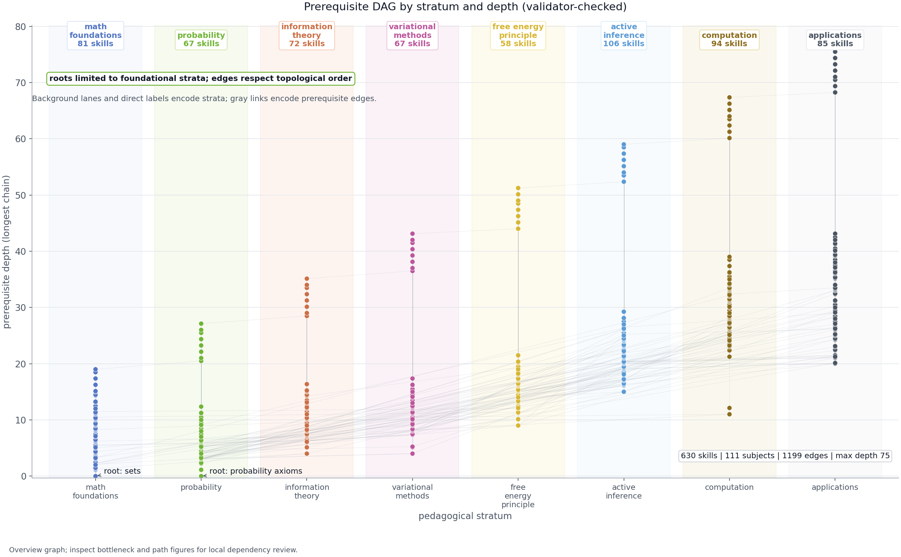

# Syntax Guide

This document defines the authoring syntax for Active Skillference manuscript and skill
content. The project's defining rule is **provenance over assertion**: every quantitative
result a reader sees is produced by a tested kernel and referenced through a
`{{claim:NAME}}` token — never hand-typed. Sections 1–3 are mandatory constraints;
sections 4–8 are reference material for common authoring operations.

---

## 1. Markdown Links

Hyperlinks must be informative. Never use placeholder text.

- **BAD**: [this link](README.md) to read more.
- **GOOD**: See the [project README](../README.md) and [AGENTS.md](../AGENTS.md).

For internal cross-references, prefer relative paths to files that exist in this project,
e.g. [`src/kernels/examples.py`](../src/kernels/examples.py) or
[`src/provenance/binding.py`](../src/provenance/binding.py).

---

## 2. Provenance tokens — `{{claim:NAME}}` (the core of the platform)

Every quantitative *result* shown in skill content or the manuscript is referenced through
a `{{claim:NAME}}` token. The token resolves at build time to a value some tested kernel
registered in a `ClaimRegistry`. A bare result number typed into prose is a defect that the
provenance linter (`src/provenance/binding.py::find_unbacked_numbers`) flags; an
unresolved token fails the build closed (`render` raises `ProvenanceError`). There is no
generic free-form variable system — only kernel-backed claim tokens.

The token grammar is defined by `CLAIM_TOKEN_RE` in
[`src/curriculum/model.py`](../src/curriculum/model.py):

```python
CLAIM_TOKEN_RE = re.compile(r"\{\{claim:([A-Za-z0-9_.\-]+)\}\}")
```

### How a number becomes a claim

The full provenance chain (also summarised in [`AGENTS.md`](../AGENTS.md)):

```
kernel fn → examples.register(...) → {{claim:NAME}} in content → render/export (fail-closed)
          → SkillTree skill description + output/data/claims.json
```

1. **Compute it in a tested kernel.** The numeric primitives live in
   [`src/kernels/`](../src/kernels/) (`information.py`, `distributions.py`, `inference.py`,
   `active_inference.py`). These are the *only* source of quantitative values.
2. **Emit it from a worked example.** Add or extend a function in
   [`src/kernels/examples.py`](../src/kernels/examples.py) that runs a kernel on a fixed,
   documented input and returns the result in a dict keyed by claim name. For example
   `info_examples()` returns `{"entropy_fair_coin": entropy([0.5, 0.5]), ...}`.
3. **Register it.** `build_claim_registry()` in the same file iterates every example
   function and calls `registry.register(name, round(value, 6), units=..., source=...)`,
   so the registered name is exactly the `{{claim:NAME}}` token content references.
4. **Reference it in prose.** In a skill description (or manuscript section), write the
   value as a token:

   ```markdown
   A fair coin carries an entropy of {{claim:entropy_fair_coin}}.
   ```

5. **Build fails closed if anything is wrong.** `validate_curriculum` /
   `validate_manuscript_text` raise if a referenced claim is not registered;
   `render` raises on any malformed or leftover `{{claim:` token.

### The currently registered claims

These are produced by `build_claim_registry()` in
[`src/kernels/examples.py`](../src/kernels/examples.py). Re-run
`uv run python scripts/run_kernels.py` to regenerate them and write
`output/data/claims.json`.

| Claim token | Emitting example function | Units |
|---|---|---|
| `{{claim:agent_epistemic_commit}}` | `agent_example()` | nats |
| `{{claim:agent_epistemic_sample}}` | `agent_example()` | nats |
| `{{claim:agent_g_commit}}` | `agent_example()` | nats |
| `{{claim:agent_g_sample}}` | `agent_example()` | nats |
| `{{claim:agent_preferred_action}}` | `agent_example()` | - |
| `{{claim:agent_regime_switch_precision}}` | `agent_example()` | - |
| `{{claim:bayes_posterior_present_given_positive}}` | `inference_examples()` | - |
| `{{claim:bmr_log_bayes_factor}}` | `model_reduction_examples()` | nats |
| `{{claim:bmr_log_evidence_full}}` | `model_reduction_examples()` | nats |
| `{{claim:bmr_log_evidence_reduced}}` | `model_reduction_examples()` | nats |
| `{{claim:bp_marginal_neighbor_node_state0}}` | `message_passing_examples()` | - |
| `{{claim:bp_marginal_observed_node_state0}}` | `message_passing_examples()` | - |
| `{{claim:bp_smoothing_lift_over_prior}}` | `message_passing_examples()` | - |
| `{{claim:cross_entropy_biased_under_fair}}` | `information_bound_examples()` | - |
| `{{claim:cross_entropy_gap_equals_kl}}` | `information_bound_examples()` | - |
| `{{claim:dirichlet_expected_dense}}` | `dirichlet_examples()` | - |
| `{{claim:dirichlet_expected_log_positive}}` | `learning_examples()` | nats |
| `{{claim:dirichlet_expected_log_sparse}}` | `dirichlet_examples()` | - |
| `{{claim:dirichlet_expected_sparse}}` | `dirichlet_examples()` | - |
| `{{claim:dirichlet_jensen_gap_dense}}` | `dirichlet_examples()` | - |
| `{{claim:dirichlet_jensen_gap_sparse}}` | `dirichlet_examples()` | - |
| `{{claim:dirichlet_posterior_mean_positive}}` | `learning_examples()` | - |
| `{{claim:dirichlet_prior_mean_positive}}` | `learning_examples()` | - |
| `{{claim:efe_ambiguity_crisp_state}}` | `efe_ambiguity_examples()` | nats |
| `{{claim:efe_ambiguity_uniform_belief}}` | `efe_ambiguity_examples()` | nats |
| `{{claim:efe_epistemic_certain}}` | `efe_examples()` | nats |
| `{{claim:efe_epistemic_uncertain}}` | `efe_examples()` | nats |
| `{{claim:efe_identity_epistemic}}` | `efe_decomposition_examples()` | - |
| `{{claim:efe_identity_pragmatic}}` | `efe_decomposition_examples()` | - |
| `{{claim:efe_identity_residual}}` | `efe_decomposition_examples()` | - |
| `{{claim:efe_identity_total}}` | `efe_decomposition_examples()` | - |
| `{{claim:efe_pragmatic_certain}}` | `efe_examples()` | nats |
| `{{claim:elbo_posterior}}` | `evidence_bound_examples()` | - |
| `{{claim:elbo_uniform}}` | `evidence_bound_examples()` | - |
| `{{claim:entropy_biased_coin}}` | `info_examples()` | nats |
| `{{claim:entropy_deficit_biased}}` | `information_bound_examples()` | - |
| `{{claim:entropy_fair_coin}}` | `info_examples()` | nats |
| `{{claim:entropy_fair_die}}` | `info_examples()` | nats |
| `{{claim:entropy_max_two_state}}` | `information_bound_examples()` | - |
| `{{claim:evidence_bound_slack_posterior}}` | `evidence_bound_examples()` | - |
| `{{claim:evidence_bound_slack_uniform}}` | `evidence_bound_examples()` | - |
| `{{claim:evidence_probability_positive}}` | `inference_examples()` | - |
| `{{claim:kl_asymmetry_gap}}` | `information_bound_examples()` | - |
| `{{claim:kl_biased_vs_fair}}` | `info_examples()` | nats |
| `{{claim:kl_fair_vs_biased}}` | `information_bound_examples()` | - |
| `{{claim:mutual_info_correlated}}` | `info_examples()` | nats |
| `{{claim:mutual_info_independent}}` | `information_bound_examples()` | - |
| `{{claim:mutual_info_skewed}}` | `information_bound_examples()` | - |
| `{{claim:neg_log_evidence_positive}}` | `inference_examples()` | nats |
| `{{claim:param_disease_prior_absent}}` | `model_parameter_examples()` | - |
| `{{claim:param_disease_prior_present}}` | `model_parameter_examples()` | - |
| `{{claim:param_informative_sensor_precision}}` | `model_parameter_examples()` | - |
| `{{claim:param_sensor_false_positive}}` | `model_parameter_examples()` | - |
| `{{claim:param_sensor_true_positive}}` | `model_parameter_examples()` | - |
| `{{claim:pc_observation}}` | `predictive_coding_examples()` | - |
| `{{claim:pc_posterior_estimate}}` | `predictive_coding_examples()` | - |
| `{{claim:pc_prior_prediction_error}}` | `predictive_coding_examples()` | - |
| `{{claim:pc_sensory_prediction_error}}` | `predictive_coding_examples()` | - |
| `{{claim:plan_best_policy_posterior}}` | `planning_examples()` | - |
| `{{claim:plan_greedy_policy_g}}` | `planning_examples()` | nats |
| `{{claim:plan_lookahead_gain_coupled}}` | `planning_examples()` | nats |
| `{{claim:plan_lookahead_gain_decoupled}}` | `planning_examples()` | nats |
| `{{claim:plan_optimal_policy_g}}` | `planning_examples()` | nats |
| `{{claim:policy_best_mass_high_precision}}` | `policy_precision_examples()` | - |
| `{{claim:policy_entropy_high_precision}}` | `policy_precision_examples()` | - |
| `{{claim:policy_entropy_low_precision}}` | `policy_precision_examples()` | - |
| `{{claim:policy_entropy_low_precision_deficit}}` | `policy_precision_examples()` | - |
| `{{claim:policy_entropy_reference_precision}}` | `policy_precision_examples()` | - |
| `{{claim:policy_entropy_uniform_ceiling}}` | `policy_precision_examples()` | - |
| `{{claim:posterior_mean_analytic_residual}}` | `precision_weighting_examples()` | - |
| `{{claim:posterior_mean_confident_prior}}` | `precision_weighting_examples()` | - |
| `{{claim:posterior_mean_confident_sensor}}` | `precision_weighting_examples()` | - |
| `{{claim:posterior_mean_precision_shift}}` | `precision_weighting_examples()` | - |
| `{{claim:precision_weight_on_observation}}` | `precision_weighting_examples()` | - |
| `{{claim:softmax_top_high_precision}}` | `softmax_examples()` | - |
| `{{claim:softmax_top_low_precision}}` | `softmax_examples()` | - |
| `{{claim:surprise_rare_event}}` | `info_examples()` | nats |
| `{{claim:vfe_descent_end}}` | `inference_examples()` | nats |
| `{{claim:vfe_descent_start}}` | `inference_examples()` | nats |

> **Single source of truth is the code, not this table.** The authoritative list is the
> return value of `build_claim_registry()`, mirrored into `output/data/claims.json`, and
> the documentation inventory test checks this table against that live registry. Treat the
> registry as canonical when adding or renaming claims.

### Where tokens are allowed, and where bare numbers are checked

The provenance gate distinguishes carefully (see
[`src/provenance/binding.py`](../src/provenance/binding.py)):

- **Result numbers** (a decimal with two or more fractional digits, or scientific
  notation) appearing in plain prose are flagged by the linter as laundered numbers.
- **Input numbers / parameters** in prose belong inside `$…$` LaTeX math, which the
  linter excludes from scanning (math spans are stripped before the number scan).
- **Integers, years, single-decimal probabilities** (e.g. `0.5`, version `4.2`) are
  deliberately *not* flagged — they are almost always parameters, not derived results.
- **Assessment answer options** are split by role: wrong distractors are out of scope
  because they legitimately contain arbitrary incorrect numbers, while correct answer
  options are scanned so a derived value cannot bypass provenance by living only in an
  answer key.

The linter scans every learner-facing expository field: skill **name**, **objective**,
**description**, each assessment **prompt**, and each correct assessment **answer**.

---

## 3. Pandoc cross-references

Inside `manuscript/` files, use Pandoc-crossref `[@label]` syntax for cross-references.
**Never** use raw LaTeX `\ref{}` macros in Markdown — they render literally in HTML/slide
outputs and bypass auto-numbering. Never hardcode a figure or table number.

- **BAD**: See Figure 1 or Figure `\ref{fig:curriculum_dag}`.
- **GOOD**: See [@fig:curriculum_dag].

### Figure label registry

Active Skillference renders deterministic publication visuals, all produced by
[`src/figures/plots/`](../src/figures/plots/) and orchestrated by
[`scripts/run_kernels.py`](../scripts/run_kernels.py). Numbered manuscript figures are
rendered via `render_all`; the first-page cover and page-two named-skill atlas are
generated separately by `plot_active_skillference_cover` and `plot_skill_name_atlas`.
Every numeric input comes from the `ClaimRegistry` or the `CurriculumGraph`. `render_all` also writes
`output/figures/figure_registry.json`, and `src/manuscript/audit.py` checks that registry
against manuscript labels, cross-references, readable nonblank PNGs, caption/alt-text
specificity, semantic metadata, claim tokens, and dashboard figure artifacts.

| Anchor / manuscript section | PNG filename | Generator function |
|---|---|---|
| `{#fig:curriculum_dag}` | `output/figures/curriculum_dag.png` | `plot_curriculum_dag(graph, path)` |
| `{#fig:dependency_strata_flow}` | `output/figures/dependency_strata_flow.png` | `plot_dependency_strata_flow(graph, path)` |
| `{#fig:graph_bottlenecks}` | `output/figures/graph_bottlenecks.png` | `plot_graph_bottlenecks(graph, path)` |
| `{#fig:skill_neighborhood_paths}` | `output/figures/skill_neighborhood_paths.png` | `plot_skill_neighborhood_paths(graph, path)` |
| `{#fig:semantic_prerequisite_coverage}` | `output/figures/semantic_prerequisite_coverage.png` | `plot_semantic_prerequisite_coverage(graph, path)` |
| `{#fig:assessment_depth}` | `output/figures/assessment_depth_matrix.png` | `plot_assessment_depth_matrix(graph, path)` |
| `{#fig:stratum_balance}` | `output/figures/curriculum_stratum_balance.png` | `plot_curriculum_stratum_balance(graph, path)` |
| `{#fig:scholarship_coverage}` | `output/figures/scholarship_coverage.png` | `plot_scholarship_coverage(audit, path)` |
| `{#fig:open_science_sources}` | `output/figures/open_science_source_map.png` | `plot_open_science_source_map(audit, path, course_material_index=..., course_material_audit=...)` |
| `{#fig:scholarship_source_health}` | `output/figures/scholarship_source_health.png` | `plot_scholarship_source_health(audit, path)` |
| `{#fig:validation_surface_matrix}` | `output/figures/validation_surface_matrix.png` | `plot_validation_surface_matrix(graph, registry, audit, path, figure_count=...)` |
| `{#fig:validation_intent_mismatch_matrix}` | `output/figures/validation_intent_mismatch_matrix.png` | `plot_validation_intent_mismatch_matrix(path, figure_count=...)` |
| `{#fig:visual_evidence_contract_ladder}` | `output/figures/visual_evidence_contract_ladder.png` | `plot_visual_evidence_contract_ladder(graph, path)` |
| `{#fig:scientific_evidence_matrix}` | `output/figures/scientific_evidence_matrix.png` | `plot_scientific_evidence_matrix(claim_support_audit, path)` |
| `{#fig:free_energy}` in `08_supplement_variational_free_energy.md` | `output/figures/free_energy_descent.png` | `plot_free_energy_descent(registry, path)` |
| `{#fig:efe}` in `08_supplement_variational_free_energy.md` | `output/figures/efe_decomposition.png` | `plot_efe_decomposition(registry, path)` |
| `{#fig:planning_lookahead}` in `08_supplement_variational_free_energy.md` | `output/figures/planning_lookahead.png` | `plot_planning_lookahead(registry, path)` |
| `{#fig:predictive_coding}` in `08_supplement_variational_free_energy.md` | `output/figures/predictive_coding_descent.png` | `plot_predictive_coding(registry, path)` |
| `{#fig:kernel_sensitivity_profiles}` in `08_supplement_variational_free_energy.md` | `output/figures/kernel_sensitivity_profiles.png` | `plot_kernel_sensitivity_profiles(registry, path)` |
| `{#fig:vfe_efe_skilltree_bridge}` in `08_supplement_variational_free_energy.md` | `output/figures/vfe_efe_skilltree_bridge.png` | `plot_vfe_efe_skilltree_bridge(graph, path)` |
| `{#fig:roadmap_risk}` | `output/figures/roadmap_risk.png` | `plot_roadmap_risk(roadmap, path)` |

`output/figures/active_skillference_cover.png` and
`output/figures/active_skillference_skill_atlas.png` are front-matter assets, not
cross-referenced figures. They are configured by `book.cover.image` and
`front_matter.page_two_visual.image`, then validated by publication-asset audits, so they
must not be added to `figure_registry.json` or declared with `{#fig:...}` anchors.

Every numbered-figure registry row carries the chart-contract fields `question`,
`takeaway`, `data_sources`, `data_grain`, `encoding`, `palette_policy`,
`palette_roots`, `non_color_encoding`, `static_read`, `mobile_read`, and
`failure_mode`. The figure code generates those fields, the dashboard displays them, and
`src/manuscript/audit.py` rejects missing, generic, or too-terse metadata.
The shared Matplotlib grammar also enforces a readability floor: meaningful chart text
uses at least the shared 9.5px-equivalent small-label size, while 8.5px is reserved for
source/caveat notes. Dense figures must reduce visible label density, wrap labels, widen
the layout, or move detail into a ledger/card rather than shrinking text.

`plot_curriculum_dag` lays skills out at `x = stratum order`, `y = prerequisite depth`,
uses wrapped direct stratum/root labels, quiet dependency edges, and graph invariant callouts.
`plot_dependency_strata_flow` aggregates prerequisite edges by source/target stratum with
row/column totals and a hatched backward-dependency safety zone. `plot_graph_bottlenecks` and
`plot_skill_neighborhood_paths` make local dependency review practical; the long-path
view uses a checkpoint ledger instead of angled micro-labels.
`plot_assessment_depth_matrix` exposes the three-question quiz floor as a PASS/REVIEW
audit table/bar hybrid. `plot_curriculum_stratum_balance` pairs raw expansion counts with
normalized per-subject and per-skill measures.
`plot_scholarship_coverage`, `plot_open_science_source_map`, and
`plot_scholarship_source_health` draw validated citation lanes and source-health checks
from `data/scholarship_sources.yaml`. `plot_validation_surface_matrix` links validation
gates to generated JSON, tests, manuscript, dashboard, release-documentation, and
SkillTree handoff surfaces;
`plot_validation_intent_mismatch_matrix` names the missing-registry, missing-file,
missing-manuscript-label, missing-dashboard-artifact, missing-roadmap-metric, and stale
manifest classes those gates are expected to reject.
`plot_visual_evidence_contract_ladder` shows the curriculum-authoring workflow from
figure question contract through negative-control validation. Each registered figure row
adds a chart contract with `question`, `takeaway`, `data_sources`, `data_grain`,
`encoding`, `palette_policy`, `palette_roots`, `non_color_encoding`, `static_read`,
`mobile_read`, and `failure_mode`; the registry stores those fields,
manuscript prose declares and references the label, the dashboard artifact card exposes
the same fields grouped as Question / Grain / Boundary / Failure plus collapsible
encoding and QA details, and the artifact validator rejects missing or generic metadata.
`plot_free_energy_descent` draws a supplemental VFE sweep over `q(present)` against
`−log evidence`. `plot_efe_decomposition` compares sample vs. commit and sweeps sensor
precision to show the supplemental regime switch. `plot_vfe_efe_skilltree_bridge` maps
those supplement figures to real SkillTree subjects, skills, prerequisite edges,
learn-route fragments and quiz-route fragments. `plot_roadmap_risk` renders the status
totals, remaining work by surface and release class, git-authorization hatching, and
live metric bars from the machine-readable roadmap state.

---

## 4. Code Blocks

Always tag code blocks with their language identifier (required for Pandoc syntax
highlighting in the PDF).

```python
from src.kernels.information import entropy

def fair_coin_entropy() -> float:
    return entropy([0.5, 0.5])
```

For shell commands:

```bash
uv run pytest tests/ --cov=src --cov-fail-under=90
```

For inline code referencing file paths, use single backticks:
`src/kernels/examples.py`.

---

## 5. LaTeX Math in Manuscript

Use `$...$` for inline math and `$$...$$` for display equations. Pandoc converts these to
LaTeX automatically, and the provenance linter treats math spans as protected (input
numbers and coefficients legitimately live there).

```markdown
Variational free energy is $F[q] = \mathrm{KL}[q \,\|\, p(s)] - \mathbb{E}_q[\ln p(o \mid s)]$,
and at the true posterior $F$ falls to the negative log-evidence: {{claim:vfe_descent_end}}.
```

If you make a display equation referable, attach a Pandoc-crossref anchor after the closing
`$$`:

```markdown
$$
F[q] = \mathrm{KL}\bigl[q(s)\,\|\,p(s)\bigr] - \mathbb{E}_{q}\bigl[\ln p(o \mid s)\bigr]
$$ {#eq:free_energy}
```

Reference with `[@eq:free_energy]`. **Never** use a raw `\begin{equation}\label{...}` block
in Markdown — pandoc-crossref will not pick up the LaTeX label.

---

## 6. Adding a New Figure

Active Skillference keeps a data-driven figure set. To add one:

1. Add a generator function to [`src/figures/plots/`](../src/figures/plots/) that takes
   the `CurriculumGraph` and/or `ClaimRegistry` plus an output `path`, draws with the
   headless `Agg` backend, and returns the `Path`. Pull every number from the graph or
   registry — never hardcode a value.
2. Wire numbered manuscript figures into `render_all(...)` so `scripts/run_kernels.py`
   renders and registers them. Cover or publication-shell assets should use a separate
   validator and must not enter `figure_registry.json`.
3. Add a test in [`tests/test_figures.py`](../tests/test_figures.py) asserting the PNG is
   written (using `tmp_path`).
4. Add the Pandoc image reference in the appropriate manuscript section:
   ```markdown
   {#fig:curriculum_dag width=80%}
   ```
   Replace both the filename and `{#fig:...}` anchor with the new registered values when
   adding a real figure.
5. Reference it in prose with `[@fig:my_label]` and re-run the kernels + artifact audit.

---

## 7. Citations (Pandoc)

Cite with the bracket form; keys must exist in
[`manuscript/references.bib`](../manuscript/references.bib) and
[`data/scholarship_sources.yaml`](../data/scholarship_sources.yaml).

```markdown
Active inference minimises expected free energy [@friston2017].
```

**Never** write raw `\cite{}` in Markdown — the bracket form renders portably across PDF
and HTML.

After adding or removing a citation, add or update its source-role row and run:

```bash
uv run python scripts/analyze_scholarship.py
```

---

## 8. Detecting unresolved tokens

A well-formed `{{claim:NAME}}` always substitutes during render; any residual `{{claim:`
is a malformed or unbacked token and is a build failure. The kernel run validates both the
curriculum and the manuscript before emitting any artifact:

```bash
uv run python scripts/run_kernels.py   # validates curriculum + manuscript, then renders
```

If `run_kernels.py` raises `ProvenanceError`, the message names the offending skill /
manuscript file and the missing claim. As a cheap pre-check you can grep the rendered
SkillTree export, which the smoke test also asserts is token-free:

```bash
grep -F "{{claim" output/data/skilltree_project.json && echo "UNRESOLVED" || echo "clean"
```

---

## See also

- [`style_guide.md`](style_guide.md) — code & content style (kernel purity, `src.*`
  imports, claim-binding rules)
- [`rendering_pipeline.md`](rendering_pipeline.md) — manuscript → PDF flow
- [`testing_philosophy.md`](testing_philosophy.md) — the no-mocks testing standard
- [`../AGENTS.md`](../AGENTS.md) — invariants and the provenance chain
