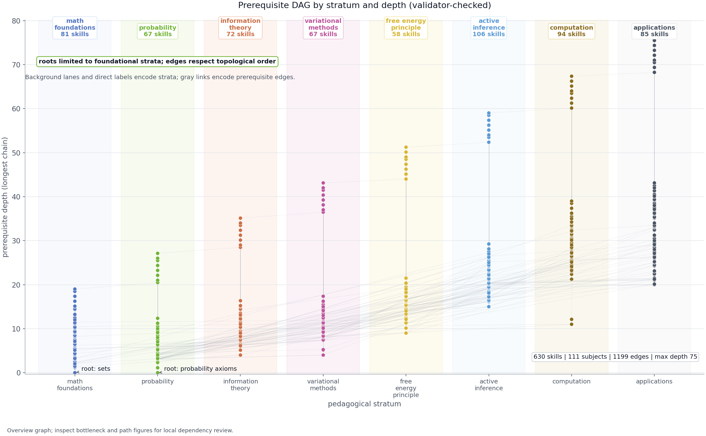

# Active Skillference Manuscript Syntax and Provenance Reference

How to author the Active Skillference manuscript: provenance-bound numbers, Pandoc
citations, equations, figures, and the cross-reference conventions the renderer expects.
The companion authoring guide is [`../docs/syntax_guide.md`](../docs/syntax_guide.md);
the rendering flow is in [`../docs/rendering_pipeline.md`](../docs/rendering_pipeline.md).

## Claim tokens and generated count variables for provenance-bound numbers

Every learner-facing *result number* the manuscript states must come from a tested kernel,
never be hand-typed. The mechanism:

1. A kernel computes the value in `../src/kernels/examples.py` and registers it as a named
   claim (`registry.register(name, value, units, source)`).
2. `scripts/run_kernels.py` builds the registry and writes the resolved values to
   `output/data/manuscript_variables.json` (every claim plus the headline curriculum
   counts `skill_count`, `subject_count`, `edge_count`, `max_depth`).
3. The manuscript references a value with a `{{claim:NAME}}` token (or a bare count token
   such as `{{skill_count}}`); the renderer substitutes the registered value.
4. `validate_manuscript_dir()` (in `../src/provenance/binding.py`), invoked by
   `run_kernels.py`, **fails the build closed** if any `{{claim:…}}` token in the
   manuscript has no backing claim, or if a bare result decimal is typed into prose
   outside `$…$` math.

```markdown
The agent's preferred epistemic action carries value {{claim:agent_epistemic_sample}},
versus {{claim:agent_epistemic_commit}} for committing.
```

**Input parameters** (a precision $p = 0.9$, a temperature) go inside `$…$` LaTeX math and
are not claims — they are assumptions, not computed results. The linter flags only bare
decimals in prose; live structural integers should use manuscript variables such as
`{{skill_count}}` or `{{strata_count}}`. The stratum total is now exported as the
`{{strata_count}}` variable, so prefer the token over the word form ("eight strata") —
that keeps the count from silently drifting if a stratum is ever added or removed.


## Pandoc citation syntax and bibliography resolution

```markdown
[@friston2017process]                      <!-- parenthetical -->
[@dacosta2020synthesis; @parr2022active]   <!-- multiple -->
@friston2010free showed that...            <!-- narrative -->
```

All citation keys must exist in [`references.bib`](references.bib). The build invokes
Pandoc with `--natbib`/`--citeproc`, so `[@key]` becomes the right LaTeX cite command;
never write raw `\cite{}` in Markdown.

## Equation environments and cross-reference labels

```markdown
$$ F = \underbrace{D_{KL}[q(s)\,\|\,p(s)]}_{\text{complexity}} - \underbrace{\mathbb{E}_{q}[\ln p(o\mid s)]}_{\text{accuracy}} $$ {#eq:vfe}
```

Reference with `[@eq:label]` (parenthetical) or `@eq:label` (narrative); never raw
`\ref`/`\eqref`. The current numbered sections present their mathematics inline and do not
yet carry `{#eq:…}` labels — add a label only when you introduce a numbered equation you
cross-reference.

## Figure declarations, references, and generated image paths

```markdown
{#fig:curriculum_dag width=95%}

[@fig:curriculum_dag] shows the prerequisite graph.
```

Images must exist in `output/figures/` at render time (regenerate with
`scripts/run_kernels.py`). Use `width=`/`height=` to avoid float-too-large warnings.

### Figure registry and generated plot contracts

| Label | PNG filename | Generator in `../src/figures/plots/` |
|---|---|---|
| `{#fig:curriculum_dag}` | `output/figures/curriculum_dag.png` | `plot_curriculum_dag()` |
| `{#fig:dependency_strata_flow}` | `output/figures/dependency_strata_flow.png` | `plot_dependency_strata_flow()` |
| `{#fig:graph_bottlenecks}` | `output/figures/graph_bottlenecks.png` | `plot_graph_bottlenecks()` |
| `{#fig:skill_neighborhood_paths}` | `output/figures/skill_neighborhood_paths.png` | `plot_skill_neighborhood_paths()` |
| `{#fig:semantic_prerequisite_coverage}` | `output/figures/semantic_prerequisite_coverage.png` | `plot_semantic_prerequisite_coverage()` |
| `{#fig:assessment_depth}` | `output/figures/assessment_depth_matrix.png` | `plot_assessment_depth_matrix()` |
| `{#fig:stratum_balance}` | `output/figures/curriculum_stratum_balance.png` | `plot_curriculum_stratum_balance()` |
| `{#fig:scholarship_coverage}` | `output/figures/scholarship_coverage.png` | `plot_scholarship_coverage()` |
| `{#fig:open_science_sources}` | `output/figures/open_science_source_map.png` | `plot_open_science_source_map()` with scholarship and course-material coverage payloads |
| `{#fig:scholarship_source_health}` | `output/figures/scholarship_source_health.png` | `plot_scholarship_source_health()` |
| `{#fig:validation_surface_matrix}` | `output/figures/validation_surface_matrix.png` | `plot_validation_surface_matrix()` |
| `{#fig:validation_intent_mismatch_matrix}` | `output/figures/validation_intent_mismatch_matrix.png` | `plot_validation_intent_mismatch_matrix()` |
| `{#fig:visual_evidence_contract_ladder}` | `output/figures/visual_evidence_contract_ladder.png` | `plot_visual_evidence_contract_ladder()` |
| `{#fig:scientific_evidence_matrix}` | `output/figures/scientific_evidence_matrix.png` | `plot_scientific_evidence_matrix()` |
| `{#fig:free_energy}` | `output/figures/free_energy_descent.png` | `plot_free_energy_descent()` |
| `{#fig:efe}` | `output/figures/efe_decomposition.png` | `plot_efe_decomposition()` |
| `{#fig:kernel_sensitivity_profiles}` | `output/figures/kernel_sensitivity_profiles.png` | `plot_kernel_sensitivity_profiles()` |
| `{#fig:vfe_efe_skilltree_bridge}` | `output/figures/vfe_efe_skilltree_bridge.png` | `plot_vfe_efe_skilltree_bridge()` |
| `{#fig:roadmap_risk}` | `output/figures/roadmap_risk.png` | `plot_roadmap_risk()` |

All manuscript figures are emitted by `render_all()` (called from `scripts/run_kernels.py`).
The figure set covers the DAG, stratum flow, graph bottlenecks, skill neighborhoods,
quiz floor-pass audit, stratum-balance load, scholarship coverage, source health, validation
surfaces, visual-evidence contract lifecycle, scientific evidence classes, supplemental
VFE/EFE walkthroughs, kernel sensitivity, and roadmap risk. Add a new figure by adding a
`plot_*` function, wiring it into `render_all()`, declaring it in the manuscript, and
registering any numbers it shows as claims or generated variables.

Each registered figure also has an additive chart contract in
`output/figures/figure_registry.json`: `question`, `takeaway`, `data_sources`,
`data_grain`, `encoding`, `palette_policy`, `palette_roots`, `non_color_encoding`,
`static_read`, `mobile_read`, and `failure_mode`. The lifecycle is: figure code emits the
PNG and contract metadata; the registry stores it; manuscript prose declares and
references the figure; the dashboard artifact card exposes the full-size image link,
then groups the first-read fields as Question / Grain / Boundary / Failure with encoding
and QA details behind disclosure; and `src/manuscript/audit.py` rejects missing or
generic contract metadata before release. Meaningful figure text stays at or above the
shared 9.5px-equivalent floor; 8.5px is reserved for source/caveat notes.

The front-matter visuals are different: `active_skillference_cover.png` is generated from
live project data and wired by `book.cover.image`, while
`active_skillference_skill_atlas.png` is generated from every authored skill name and
wired by `front_matter.page_two_visual.image`; the atlas displays a reduced readable term
sample and representative checkpoints, not the full printed name ledger. Do not add
either asset to this table or to `figure_registry.json`; publication-asset audits
validate them separately from numbered manuscript figures.

## BibTeX entries and source-role matrix rows

```bibtex
@article{friston2017process,
  author  = {Friston, Karl and FitzGerald, Thomas and Rigoli, Francesco and Schwartenbeck, Philipp and Pezzulo, Giovanni},
  title   = {Active inference: a process theory},
  journal = {Neural Computation},
  year    = {2017},
  volume  = {29},
  number  = {1},
  pages   = {1--49}
}
```

- Keys are lowercase alphanumeric with optional underscores.
- Every entry needs at minimum `author`, `title`, `year`.
- DOIs are added only once Crossref-verified (see the note in `references.bib`).
- Every cited key also needs a source-role row in
  [`../data/scholarship_sources.yaml`](../data/scholarship_sources.yaml). Run
  `uv run python scripts/analyze_scholarship.py` after citation edits.

## Section assembly order and optional labels

Files are assembled in lexicographic order by the renderer; `00_` puts the abstract first
and `99_` puts the references last:

```text
00_abstract.md  01_introduction.md  02_methodology.md  02a_*.md  02b_*.md  02c_*.md
03_results.md  03a_*.md  03b_*.md  03c_*.md  03d_*.md  04_conclusion.md
05_experimental_setup.md  06_reproducibility.md  07_scope_and_related_work.md
07a_*.md  07b_*.md  07c_*.md  07d_*.md  08_supplement_variational_free_energy.md
99_references.md
```

Section H1s are plain headings; the References H1 carries `{#sec:references}`. Add a
`{#sec:<name>}` label to a heading only when you cross-reference it with `[@sec:<name>]`.

## LaTeX preamble and renderer-owned packages

[`preamble.md`](preamble.md) holds the LaTeX packages Pandoc consumes (e.g. `amsmath`,
`cleveref`, `natbib`). Do not duplicate packages the parent renderer already injects.

## Prose conventions for provenance-bound manuscript text

- No "In summary"/"In conclusion" closers unless a section genuinely needs one.
- Active voice for methodology.
- Reference code by concrete path: `src/kernels/information.py`, not "the information module".
- Every result number is a `{{claim:…}}` token; input parameters live in `$…$` math.

## Related authoring references

- [`README.md`](README.md) — directory orientation
- [`AGENTS.md`](AGENTS.md) — agent editing protocol for the manuscript
- [`../docs/rendering_pipeline.md`](../docs/rendering_pipeline.md) — manuscript → PDF flow
- [`../docs/syntax_guide.md`](../docs/syntax_guide.md) — authoring guide
- [`../src/provenance/binding.py`](../src/provenance/binding.py) — claim-token validation/substitution
- [`preamble.md`](preamble.md) — LaTeX preamble
