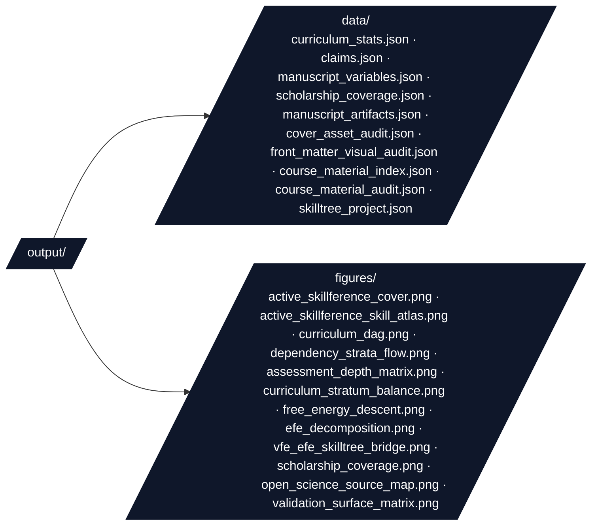

# Script Conventions

Orchestration rules and integration patterns for `scripts/` in the Active Skillference platform.

## Thin Orchestrator Rules

Scripts **coordinate** — they never **compute**. All curriculum, kernel, provenance,
and SkillTree logic lives in `src/`; scripts build, gate, and write artifacts.

```python
# ✅ CORRECT: Script imports from src/ and orchestrates
from src.curriculum.catalog import build_curriculum
from src.kernels.examples import build_claim_registry
from src.provenance.binding import validate_curriculum, render_graph
from src.skilltree import export_to_json

graph = build_curriculum()  # validates internally
registry = build_claim_registry()  # runs the kernels, registers claims
validate_curriculum(graph.skills, registry)  # fail closed on any unbacked token
rendered = render_graph(graph, registry)  # substitute every {{claim:NAME}}
export_to_json(rendered, "activeInference", "Active Skillference", out_path)
```

```python
# ❌ WRONG: Script reimplements a kernel or hand-types a result
def my_entropy(p):  # math belongs in src/kernels/information.py
    return -sum(x * math.log(x) for x in p)


description = "Fair-coin entropy is 0.693 nats"  # hand-typed result number!
```

If you find yourself computing a number in `scripts/`, move it into a kernel in
`src/kernels/`, register it as a claim in `src/kernels/examples.py`, and reference it
via a `{{claim:NAME}}` token. Never type a result number into learner-facing content.

## Import Patterns

Every script puts the project root and `src/` on `sys.path`, then imports under the
`src.*` namespace (matching the `pythonpath = [".", "src"]` test config):

```python
import sys
from pathlib import Path

_ROOT = Path(__file__).resolve().parents[1]
sys.path.insert(0, str(_ROOT))
sys.path.insert(0, str(_ROOT / "src"))

from src.curriculum.catalog import build_curriculum  # noqa: E402
from src.project_paths import project_output_dirs  # noqa: E402
```

- Always import under the `src.*` namespace. Do **not** use bare `kernels.`/
  `curriculum.`/`skilltree.` imports — they create dual module identities under the
  dual-path config and break the provenance/DAG invariants subtly.
- Use explicit imports (not `from module import *`).
- The `# noqa: E402` is expected: imports follow the `sys.path` setup.

## Output Directory Structure

Scripts resolve output paths through `src.project_paths.project_output_dirs()` and
write deterministic, sorted JSON and figures under `output/`:



```python
from src.project_paths import project_output_dirs

dirs = project_output_dirs()
data_dir = dirs["data"]
fig_dir = dirs["figures"]
data_dir.mkdir(parents=True, exist_ok=True)
```

## Determinism

- Every kernel result is deterministic; any stochastic example uses the fixed seed
  in `src.kernels.examples.SEED`. Re-running the scripts must reproduce every number
  and every figure byte-for-byte.
- JSON artifacts are written with `indent=2, sort_keys=True` so diffs are stable.
- Figures use the headless `Agg` matplotlib backend (set in `src/figures/plots/`).

## Fail-Closed Provenance

The pipeline refuses to emit learner-facing artifacts when provenance is broken:

- `validate_curriculum` raises if any skill references an unbacked claim token.
- `validate_manuscript_dir` raises if any `manuscript/*.md` references a dead token.
- `validate_scholarship` raises if a manuscript citation lacks a BibTeX entry or
  source-role matrix row, or if the bibliography/source matrix contains stale uncited
  entries.
- `lint_graph` returns bare result numbers hand-typed into prose; `export_skilltree.py`
  refuses to export when the list is non-empty.
- `render_graph` raises on any unbacked **or malformed** token (e.g. `{{claim:}}`).

Never wrap these calls in `try/except ... pass` to "get the build to pass" — a broken
provenance gate is a build failure by design.

## Infrastructure Integration Checklist

Before submitting a new or modified script, verify:

- [ ] No curriculum/kernel/provenance/SkillTree logic in the script — all in `src/`
- [ ] No hand-typed result numbers; every value flows through a `{{claim:NAME}}` token
- [ ] Imports use the `src.*` namespace after the `sys.path` setup
- [ ] Output written under `output/` via `project_output_dirs()`, deterministic + sorted
- [ ] Uses `Path` objects (not string concatenation) for file paths
- [ ] Stochastic steps seeded with `src.kernels.examples.SEED`
- [ ] The script's stdout paths are picked up by `tests/test_scripts_smoke.py`

## See Also

- [`AGENTS.md`](AGENTS.md) — Agent guide for `scripts/`
- [`README.md`](README.md) — Quick reference for this directory
- [`../src/STYLE.md`](../src/STYLE.md) — Style guide for the code scripts import
- [`../src/AGENTS.md`](../src/AGENTS.md) — Source-code boundaries and invariants
- [`../docs/architecture.md`](../docs/architecture.md) — Thin-orchestrator flow
