# scripts/ — Thin Orchestrators

These scripts are **thin orchestrators**. As per the Active Skillference policy,
they contain *no business logic*: they only import from `src/`, run the pipeline,
and write deterministic artifacts under `output/`. The curriculum, kernels,
provenance gate, and SkillTree mapping all live in `src/` — scripts coordinate I/O.

## Quick Start

The gate arms run these scripts in dependency order; `.github/workflows/gates.yml` calls
the arms, so CI and a local run are the same command text:

```bash
./gates.sh all         # every offline arm (see ../docs/gates.md)
./gates.sh artifacts   # curriculum → kernels/figures → SkillTree export
./gates.sh checks      # the provenance/scholarship/manuscript/roadmap validators
```

```bash
uv sync
uv run python scripts/build_curriculum.py     # DAG stats + diagnostic gap map
uv run python scripts/analyze_scholarship.py  # scholarship coverage + health network
uv run python scripts/run_kernels.py          # claims, scholarship, figures, companions, audits
uv run python scripts/build_course_materials.py
uv run python scripts/validate_course_material_sources.py --online
uv run python scripts/validate_course_material_alignment.py
uv run python scripts/validate_scholarship_sources.py
uv run python scripts/audit_scholarship_gaps.py
uv run python scripts/validate_docker_digests.py
uv run python scripts/validate_manuscript_artifacts.py
uv run python scripts/validate_manuscript_variables.py
uv run python scripts/validate_rendered_freshness.py
uv run python scripts/validate_american_english.py
uv run python scripts/validate_live_counts.py
uv run python scripts/validate_roadmap.py
uv run python scripts/validate_release_readiness_inventory.py
uv run python scripts/validate_learner_pilot_contract.py
uv run python scripts/export_skilltree.py      # provenance-gated SkillTree project JSON
uv run python scripts/ensure_web_math.py       # normalize rendered HTML MathJax
uv run python scripts/validate_web_math.py     # fail if web math cannot render
```

```bash
# View generated outputs
ls -la output/data/        # stats, claims, scholarship, course materials, artifact audit, SkillTree JSON
ls -la output/figures/     # generated PNGs plus figure_registry.json
```

## Scripts

| Script | Role | Reads | Writes |
| --- | --- | --- | --- |
| `build_curriculum.py` | Build and validate the prerequisite DAG; print and persist graph stats plus diagnostic gap-map rows | `src.curriculum.catalog`, `src.curriculum.diagnostics` | `output/data/curriculum_stats.json`, `output/data/curriculum_diagnostic_gap_map.json` |
| `analyze_scholarship.py` | Validate manuscript citation coverage and render scholarship/source figures, including the open-science learning-source ledger with course-material coverage, frontier gap report, and source-health network | `src.scholarship`, `src.manuscript.claim_support`, `src.curriculum.materials`, `src.figures`, `data/scholarship_sources.yaml`, `data/course_material_sources.yaml`, `manuscript/` | `output/data/scholarship_coverage.json`, `output/data/scholarship_source_health.json`, `output/data/scholarship_source_health_network.json`, `output/data/scholarship_gap_report.json`, scholarship and open-science learning-source figures |
| `audit_scholarship_gaps.py` | Validate high-value frontier sources against manuscript citation, BibTeX, and claim-support bindings | `src.scholarship.gap_report`, `src.manuscript.claim_support`, `data/scholarship_sources.yaml`, `data/manuscript_claim_support.yaml`, `manuscript/` | `output/data/scholarship_gap_report.json` |
| `run_kernels.py` | Print the generated-output bundle emitted by `src.pipeline.generated_outputs`; the pipeline runs kernels, provenance, American English, scholarship, scholarship-gap, claim-support, roadmap, figure/front-matter, manuscript/dashboard artifact, and course-material gates | `src.pipeline.generated_outputs`, `src.kernels`, `src.provenance`, `src.scholarship`, `src.curriculum`, `src.figures`, `src.manuscript`, `src.dashboard`, `src.roadmap` | `output/data/claims.json`, `output/data/curriculum_diagnostic_gap_map.json`, `output/data/manuscript_variables.json`, `output/data/scholarship_coverage.json`, `output/data/scholarship_source_health.json`, `output/data/scholarship_source_health_network.json`, `output/data/scholarship_gap_report.json`, `output/data/figure_table_companions.json`, `output/data/manuscript_claim_support.json`, `output/data/manuscript_artifacts.json`, `output/data/cover_asset_audit.json`, `output/data/front_matter_visual_audit.json`, `output/data/course_material_index.json`, `output/data/course_material_audit.json`, figures and `figure_registry.json` in `output/figures/` |
| `build_course_materials.py` | Build local read-only dashboard lesson records with pinned external material pointers | `src.curriculum`, `src.kernels`, `data/course_material_sources.yaml` | `output/data/course_material_index.json`, `output/data/course_material_audit.json` |
| `validate_course_material_sources.py` | Validate the pinned external source contract for dashboard Learn pointers; `--online` verifies GitHub commits, globs, and paths | `src.curriculum.materials`, `data/course_material_sources.yaml` | none (exit 0/1) |
| `validate_course_material_alignment.py` | Validate exported skills, local lesson records, learning-path prerequisite lists, handoff routes, and quiz definitions agree | `src.curriculum.alignment`, `output/data/skilltree_project.json`, course-material artifacts | none (exit 0/1) |
| `validate_scholarship_sources.py` | Re-check scholarship locator syntax, role specificity, lane coverage, and optional online reachability | `src.scholarship.source_health`, `data/scholarship_sources.yaml`, `manuscript/references.bib` | `output/data/scholarship_source_health.json` |
| `validate_docker_digests.py` | Fail if Docker images are referenced by mutable tags without digest pins | `docker-compose.yml` | none (exit 0/1) |
| `validate_claim_support.py` | Re-check anchored manuscript scientific claims against computed, count, simulation, literature, scope-limit, delivery, and visual evidence classes | `data/manuscript_claim_support.yaml`, `src.manuscript.claim_support`, `manuscript/`, scholarship matrix | `output/data/manuscript_claim_support.json` |
| `validate_manuscript_artifacts.py` | Re-check generated figure registry, manuscript figure labels/cross-references, PNG readability/information content, captions, alt text, semantic metadata, visual QA contract fields, dense figure companion ids, claim tokens, dashboard figure artifacts, and front-matter visual assets | `src.manuscript`, `src.dashboard`, `manuscript/`, `output/figures/`, `output/data/figure_table_companions.json` | `output/data/manuscript_artifacts.json`, `output/data/cover_asset_audit.json`, `output/data/front_matter_visual_audit.json` |
| `validate_manuscript_variables.py` | Fail if manuscript prose hard-codes live generated counts instead of variable tokens | `output/data/manuscript_variables.json`, `manuscript/` | none (exit 0/1) |
| `validate_rendered_freshness.py` | Fail if rendered manuscript or publication-bundle roadmap prose is stale versus current variables/artifacts | `manuscript/`, `output/manuscript/`, `output/pdf/`, `output/web/`, `output/docx/`, `output/epub/`, `output/slides/` | none (exit 0/1) |
| `validate_american_english.py` | Fail if authored manuscript markdown uses British spelling variants instead of American English | `src.manuscript.american_english`, `manuscript/*.md` | none (exit 0/1) |
| `validate_live_counts.py` | Fail if authored docs, metadata, roadmap, or manuscript surfaces carry stale generated counts | `src.live_counts`, docs, metadata, manuscript, `tasks.yaml`, `TODO.md` | none (exit 0/1) |
| `validate_roadmap.py` | Validate `tasks.yaml` schema, generated metrics, evidence commands, exact generated `TODO.md` text, and generated active `docs/todo/*.md` handoff pages | `src.roadmap`, `tasks.yaml`, `TODO.md`, `docs/todo/` | none by default; `--write-todo` refreshes `TODO.md` and `docs/todo/*.md` |
| `validate_learner_pilot_contract.py` | Validate the protocol-only learner-pilot contract, privacy boundary, event schema, outcomes, and missing-data policy | `src.pilot.contract`, `data/learner_pilot_contract.json` | none; prints a deterministic contract summary |
| `validate_release_readiness_inventory.py` | Validate or regenerate the release inventory against real git status, untracked files, tracked diff stat, and ignored generated-output examples | `src.release_readiness`, `docs/release_readiness_inventory.md`, git status | none by default; `--write` refreshes `docs/release_readiness_inventory.md` and current blocker probes |
| `ensure_web_math.py` | Insert MathJax into rendered web HTML files that contain math but lack the loader | `src.manuscript.web_math`, `output/web/` | normalized `output/web/*.html` |
| `validate_web_math.py` | Fail if dashboard or rendered web HTML math surfaces lack MathJax support | `src.dashboard/assets/`, `output/web/` | none (exit 0/1) |
| `publish_zenodo_deposit.py` | Upload the release artifact to the reserved Zenodo draft and publish it, minting a permanent DOI | `ZENODO_PROD_TOKEN`, `data/zenodo_reservation.json`, a release file | published deposit JSON on stdout |
| `reserve_zenodo_doi.py` | Reserve a Zenodo DOI on an unpublished draft deposition; never publishes | `ZENODO_PROD_TOKEN` from a dotenv file, `.zenodo.json` | JSON reservation summary on stdout |
| `capture_dashboard_screenshots.py` | Capture the registered learner-dashboard evidence screenshots from a running local stack and write their provenance record | Chrome via `chrome-devtools-axi`, running dashboard, `src.screenshots` manifest | PNGs plus `screenshot_provenance.json` under `manuscript/assets/screenshots/` |
| `validate_dashboard_console.py` | Browser-console proof for the dashboard, with optional required-browser and required-dashboard modes | Chrome via `chrome-devtools-axi`, dashboard URL | none (exit 0/1) |
| `validate_skilltree_form_login.py` | Browser proof that the raw local SkillTree `FORM` login reaches the authenticated administrator surface without leaking local secrets | Chrome via `chrome-devtools-axi`, `.active_skillference_local/skilltree_auth.json`, SkillTree login URL | JSON proof summary on stdout |
| `validate_live_skilltree_dashboard.py` | CLI wrapper around `src.dashboard.live_validation`; fails if the local dashboard is not wired to a reachable SkillTree service, current export counts, complete artifacts, ready local auth, token exchange, and optional live parity checks | `src.dashboard.live_validation`, `output/data/skilltree_project.json`, dashboard `/api/status`, SkillTree `/public/status` | none (exit 0/1) |
| `validate_full_app_stack.py` | CLI wrapper around `src.integration.full_app_stack` for the strict Docker + SkillTree + dashboard + browser proof, including dependency reconciliation unless `--app-ready` is selected | `src.integration.full_app_stack`, Docker/Compose, local SkillTree, dashboard, generated artifacts | JSON proof summary on stdout plus a redacted proof artifact under the state directory |
| `reconcile_live_dependencies.py` | Idempotently reconcile exported learning-path dependencies into a live local SkillTree service when bulk seeding leaves edge parity incomplete | `output/data/skilltree_project.json`, live SkillTree REST API | network (updates local SkillTree dependencies) |
| `reset_local_skilltree.py` | Back up and reset ignored local SkillTree bootstrap state before rerunning app-ready validation | `.active_skillference_local/`, Docker/Compose, local SkillTree dashboard state | ignored local runtime state + optional app-ready proof |
| `z_generate_manuscript_variables.py` | Template-render hook; rerun kernels (or reuse the current artifacts with `--skip-kernels`) and write provenance-resolved manuscript copies | `scripts/run_kernels.py`, `src.kernels`, `src.provenance`, `manuscript/` | `output/manuscript/*.md` |
| `render_manuscript.py` | Authoritative render path: hydrate sections, assemble them, and drive Pandoc → XeLaTeX (PDF) and Pandoc → HTML (web) | `output/manuscript/`, `manuscript/config.yaml`, `manuscript/preamble.md`, `manuscript/references.bib`, `output/figures/` | `output/pdf/Active_Skillference_combined.pdf`, `output/web/index.html` |
| `check_docs_links.py` | Fail if a relative Markdown link or image in the authored docs does not resolve on disk | every authored `*.md` surface, `README.md`, `AGENTS.md` | none (exit 0/1) |
| `z_generate_gate_metrics.py` | Render `docs/gate_metrics.md` from the recorded arm-timing receipt, or `--check` that it is current | `docs/_generated/arm_timings.json` | `docs/gate_metrics.md` with `--write`; none with `--check` |
| `export_skilltree.py` | Provenance-gate the curriculum and export a SkillTree-native project JSON | `src.curriculum`, `src.kernels`, `src.provenance`, `src.skilltree` | `output/data/skilltree_project.json` |
| `seed_skilltree.py` | Build + render the project and seed it into a live SkillTree server over REST | `src.curriculum`, `src.kernels`, `src.provenance`, `src.skilltree` | network (a running SkillTree instance) |
| `bootstrap_local_skilltree.py` | Bootstrap local SkillTree `FORM` auth, seed the project, and store ignored trusted-client state | `src.curriculum`, `src.kernels`, `src.provenance`, `src.skilltree.local_auth` | network + `.active_skillference_local/` |
| `serve_learner_dashboard.py` | Serve the local learner dashboard shell | `src.dashboard` | local HTTP server at `http://127.0.0.1:8765` |
| `validate_gnn_spec.py` | Validate the discrete-agent GNN specification against the pinned GNN revision and the kernel | `gnn/`, `src.gnn_conformance` | none (exit 0 pass, 1 conformance failure, 2 GNN unavailable) |
| `run_skilltree.sh` | One command: bring up Docker SkillTree + Postgres, wait for the API, then seed | `docker-compose.yml`, `vendor/` | a running instance at `http://localhost:8080` |
| `run_learning_dashboard.sh` | One command: bring up Docker SkillTree, regenerate/export/seed, then serve the learner dashboard | `docker-compose.yml`, `src.dashboard`, `vendor/` | SkillTree plus dashboard |

## What each script does

### `build_curriculum.py`
Calls `build_curriculum()` (which validates internally — any cycle, dangling
prerequisite, duplicate id, self-loop, or non-foundational root raises). Prints
`skills / subjects / prerequisite edges`, strata coverage (`/8`), max depth, and
foundations→applications connectivity, then writes `curriculum_stats.json` and
`curriculum_diagnostic_gap_map.json`.

### `run_kernels.py`
Calls `src.pipeline.generated_outputs.build_generated_outputs()` and prints the returned
`GeneratedOutputBundle`. The importable pipeline builds the claim registry from
`src.kernels.examples.build_claim_registry()` and the validated graph, runs the
provenance gate against **both** the curriculum and every `*.md` under `manuscript/` if
present, validates American English manuscript prose and scholarship support, writes the
claim/support/scholarship/course-material/manuscript-artifact JSON outputs, renders the
cover, page-two atlas and registered figures, writes dense figure table companions, and validates the figure/dashboard
contract before returning the exact paths written.

### `build_course_materials.py`
```bash
uv run python scripts/build_course_materials.py
uv run python scripts/validate_course_material_sources.py --online
uv run python scripts/validate_course_material_alignment.py
```
Builds one local modular lesson record per curriculum skill. The source contract is
`data/course_material_sources.yaml`: it pins external Active Inference Institute
repositories by commit, maps strata/topics to source paths, and keeps upstream material
as links rather than copied prose. The online validator checks that configured commits,
path globs, and pointer paths exist in GitHub before the dashboard relies on them.
The alignment validator then checks the generated SkillTree export and material index as
one contract: every skill has one material record, one quiz, matching prerequisite rows,
matching assessment counts, and the safe subject/quiz handoff routes.

### `validate_manuscript_variables.py`
```bash
uv run python scripts/validate_manuscript_variables.py
```
Checks manuscript section files against `output/data/manuscript_variables.json` and fails
if live counts such as skills, subjects, edges, quizzes, assessments, claims, figures, or
citations are hard-coded instead of referenced through the generated variable map.

### `validate_rendered_freshness.py`
```bash
uv run python scripts/validate_rendered_freshness.py
```
Checks that `output/manuscript/*.md` still matches the current authored manuscript and
`output/data/manuscript_variables.json`. It also scans rendered publication bundle text
artifacts under `output/pdf/`, `output/web/`, `output/docx/`, `output/epub/`, and
`output/slides/` for stale roadmap-open-count prose. Run it after changing
`tasks.yaml`, manuscript variables, or any publication-render path.

### `validate_release_readiness_inventory.py`
```bash
uv run python scripts/validate_release_readiness_inventory.py
uv run python scripts/validate_release_readiness_inventory.py --write
```
Checks `docs/release_readiness_inventory.md` against real `git status --short`,
`git ls-files -o --exclude-standard`, `git diff --stat`, ignored generated-output
examples, and required evidence commands. `--write` regenerates the inventory from the
current checkout and refreshes the public-repository and Docker blocker probe summaries;
it does not stage, commit, push, clean, or publish anything.

### `analyze_scholarship.py`
```bash
uv run python scripts/analyze_scholarship.py
```
Validates authored manuscript citations against `manuscript/references.bib` and
`data/scholarship_sources.yaml`, builds the course-material coverage payload from
`data/course_material_sources.yaml`, writes `output/data/scholarship_coverage.json` and
`output/data/scholarship_source_health_network.json`, and
renders both `output/figures/scholarship_coverage.png` and
`output/figures/open_science_source_map.png`. This is the direct check to run after adding
or removing citations or changing the open-science learning-source ledger.

### `audit_scholarship_gaps.py`
```bash
uv run python scripts/audit_scholarship_gaps.py
```
Builds `output/data/scholarship_gap_report.json`, a small frontier-source audit over the
already-clean scholarship matrix. It checks that curated formal-provenance,
knowledge-space, pedagogy, assessment, design-based-evaluation, reproducibility,
open-science, accessibility, security, and course-material-provenance sources are cited,
BibTeX-backed, and tied to the intended claim-support class. Boundary-sensitive rows must
also appear in a scope-limit or limitation-marked claim-support row so scholarship does
not inflate into learner-efficacy, public-release, or security-assurance claims.

### `validate_manuscript_artifacts.py`
```bash
uv run python scripts/validate_manuscript_artifacts.py
```
Re-validates `output/figures/figure_registry.json` against manuscript figure declarations,
`[@fig:...]` references, readable nonblank PNG files, caption/alt-text specificity,
semantic metadata, visual QA fields, claim tokens, and dashboard figure artifact entries.
It also validates table companions for dense registered figures, plus `book.cover.image`
and `front_matter.page_two_visual.image` as
non-registered front-matter assets. The figure source separately enforces the readability
contract: meaningful chart text stays at or above the shared 9.5px-equivalent floor,
8.5px is reserved for source/caveat notes, and dense output uses wrapping, ledgers, or
reduced label density instead of micro-type. This is the direct check to run after
changing a figure label, dashboard artifact entry, front-matter visual, or manuscript
figure reference without re-running all kernels.

### `validate_docker_digests.py`
```bash
uv run python scripts/validate_docker_digests.py
```
Checks Docker image references for digest pins. This is a supply-chain lint, not a live
runtime proof; Docker does not need to be running for it to pass or fail.

### `ensure_web_math.py` / `validate_web_math.py`
```bash
uv run python scripts/ensure_web_math.py
uv run python scripts/validate_web_math.py
```
The first script normalizes rendered `output/web/*.html` files so math-bearing pages load
MathJax. The second script fails if the dashboard app or generated web output can still
surface raw math delimiters without a MathJax loader.

### `z_generate_manuscript_variables.py`
Runs the same kernel/provenance gate, then writes resolved manuscript Markdown to
`output/manuscript/` for the sibling template renderer. Source manuscripts keep
their `{{claim:NAME}}` tokens so review can audit which numbers are generated.

### `export_skilltree.py`
Fail-closed export: build + validate the DAG, build the claim registry,
`validate_curriculum` (every token resolves), `lint_graph` (no bare result numbers in
learner-facing prose), `render_graph` (substitute every token — raises on any
unbacked or malformed token), then `export_to_json` into the SkillTree
`Project → Subject → Skill` model. If anything is unbacked, nothing is written.

### `seed_skilltree.py`
```bash
uv run python scripts/seed_skilltree.py --base-url http://localhost:8080 [--token TOKEN] [--require-live]
```
Builds the provenance-rendered SkillTree project offline, then drives
`src.skilltree.seed` to create it over REST in dependency-safe order
(project → subjects → quizzes → skills → dependencies). Without `--require-live`, the
script exits successfully with a skip message if no server is listening; render pipelines
therefore do not require Docker. Use `--require-live` when a live seed must fail if the
server is absent. In local `FORM` auth mode, live admin writes return `401` until you
provide valid SkillTree admin credentials for the deployment; pass a supported bearer
token with `--token` or `SKILLTREE_TOKEN` when your SkillTree instance accepts one.

### `bootstrap_local_skilltree.py`
```bash
uv run python scripts/bootstrap_local_skilltree.py --base-url http://localhost:8080
uv run python scripts/bootstrap_local_skilltree.py --check
uv run python scripts/bootstrap_local_skilltree.py --show-local-credentials
```
Bootstraps the local no-login learner path. If SkillTree is fresh, it creates a generated
root/admin account, stores local-only state under `.active_skillference_local/`, seeds
`activeInference` with a session/XSRF-aware admin client, obtains the project
trusted-client secret, and verifies that SkillTree will issue a token for
`local-learner`. Fresh local bootstraps use the documented development login
`active-skillference-admin@localhost.invalid` / `active-skillference-local`, overrideable
with `ACTIVE_SKILLFERENCE_LOCAL_ADMIN_USERNAME` and
`ACTIVE_SKILLFERENCE_LOCAL_ADMIN_PASSWORD`. Existing local state is never silently
overwritten; `--show-local-credentials` prints the current ignored local
username/password without printing the trusted-client secret. `--check` prints
browser-safe readiness without network calls. `--skip-dependencies` seeds
project/subjects/quizzes/skills only so the dedicated dependency reconciler can report
progress and resume the slow prerequisite phase. `--skip-seed-if-live-counts-ready`
avoids repeating idempotent core creates when live SkillTree already reports the exported
subject and skill counts.

### `reconcile_live_dependencies.py`
```bash
uv run python scripts/reconcile_live_dependencies.py
uv run python scripts/reconcile_live_dependencies.py --check-only
uv run python scripts/reconcile_live_dependencies.py --max-runtime-seconds 900
uv run python scripts/reconcile_live_dependencies.py --max-edges 25
uv run python scripts/reconcile_live_dependencies.py --attempts-per-edge 3
```
Reads `output/data/skilltree_project.json`, logs in with ignored local SkillTree state,
reads the live dependency graph, posts only missing prerequisite edges, writes
`.active_skillference_local/dependency_seed_progress.json`, and emits a final JSON parity
summary. If a dependency POST times out, it polls the live graph before retry/failure so
slow successful writes are not double-counted; after the poll window it takes one more
authoritative read, and an edge visible there counts as `confirmedAfterTimeout` rather
than a failure. `--attempts-per-edge` (default 2) bounds how many times a single edge may
be posted before the run fails — at 600-skill scale on emulated Docker a write can exceed
the client timeout without landing while the next attempt succeeds, and aborting the whole
run on the first such write discards all remaining progress. Pass `1` to restore
fail-on-first-error behavior.
Use `--check-only` for a no-write status refresh. Use `--max-edges` or
`--max-runtime-seconds` to run bounded resume chunks; partial runs emit JSON with
`stoppedReason` and intentionally exit non-zero until live parity is complete. The live
SkillTree graph is authoritative; the progress file is advisory resume/diagnostic state.

### `reset_local_skilltree.py`
```bash
uv run python scripts/reset_local_skilltree.py --confirm-local-reset
```
Explicit local recovery for stale SkillTree browser-login state. This is intentionally
local-destructive: it stops the detached dashboard process recorded in
`.active_skillference_local/dashboard.pid` if present, backs up
`.active_skillference_local/skilltree_auth.json`, runs `docker compose down -v`, removes
the stale state file, and reruns
`validate_full_app_stack.py --skip-regenerate --keep-running --app-ready`. Use it when
`http://localhost:8080` is reachable but raw SkillTree login rejects the documented
fresh-bootstrap credentials because an older local Docker volume still has an older
non-email root account.
Pass `--require-live-dependencies` when reset should wait for complete live prerequisite
parity instead of returning at app-ready.
On slow Docker/Colima hosts, bootstrap admin calls use a longer local timeout by default;
override it with `ACTIVE_SKILLFERENCE_SKILLTREE_REQUEST_TIMEOUT=<seconds>` if a single
SkillTree dependency write needs more time. The reset wrapper itself defaults to a long
timeout because a fresh 630-skill local SkillTree volume can spend a long time writing
the final prerequisite edges under the pinned amd64 container.

### `serve_learner_dashboard.py`
```bash
uv run python scripts/serve_learner_dashboard.py [--skilltree-url http://localhost:8080] [--host 127.0.0.1] [--port 8765]
uv run python scripts/serve_learner_dashboard.py --check
```
Serves the local no-build learner dashboard. The dashboard reads generated artifacts and
uses the official SkillTree client display when an authenticator is explicitly configured
or when `--local-auth` can use the bootstrapped `/api/skilltree/token` bridge. With
`--no-local-auth` or incomplete local state it falls back to direct SkillTree links and
the local curriculum/artifact explorer. `--check` prints the same status payload without
starting a long-running server.
The running server also exposes `/healthz` for a minimal local readiness check.

### `publish_zenodo_deposit.py`
```bash
uv run python scripts/publish_zenodo_deposit.py \
  --file Active_Skillference_v1.0.0_DOI-10.5281-zenodo.21865644.pdf --confirm-publish
```
The irreversible half of the DOI workflow, kept in its own script for that reason.
Uploads the release artifact to the draft recorded in `data/zenodo_reservation.json`, then
publishes it, which mints a permanent public record that cannot be deleted. It refuses to
run without `--confirm-publish`, and refuses to publish a deposit whose DOI does not match
the recorded reservation, so a record cannot be minted under an identifier the repository
does not already claim. After publishing, set `submitted` and `resolves` to true in the
reservation record.

### `reserve_zenodo_doi.py`
```bash
uv run python scripts/reserve_zenodo_doi.py
uv run python scripts/reserve_zenodo_doi.py --reuse-existing
```
Creates an unpublished Zenodo draft and returns the DOI Zenodo allocates to it. The
identifier is real and cannot be issued to anyone else, but it does not resolve until the
draft is published, so it is carried on the cover page as `publication.doi_status` plain
text rather than as a `doi.org` link, with the reservation recorded in
`data/zenodo_reservation.json` and cross-checked by `tests/test_publication_readiness.py`.
There is deliberately no publish path here: minting a live DOI is permanent and belongs to
a human running the release tooling. `--reuse-existing` reports the current draft instead
of burning another identifier.

### `capture_dashboard_screenshots.py`
```bash
uv run python scripts/capture_dashboard_screenshots.py
uv run python scripts/capture_dashboard_screenshots.py --dashboard-url http://127.0.0.1:8765
```
Drives a real browser over the running dashboard and records the views registered in
`src/screenshots/manifest.py` as manuscript evidence. Unlike the deterministic figures these
images cannot be rebuilt from project data, so they are version-controlled under
`manuscript/assets/screenshots/` rather than generated into `output/`, are registered in
`figure_registry.json` with `evidence_kind: captured`, and are excluded from the
render/registry parity check. Each run rewrites `screenshot_provenance.json` with the
dashboard URL, viewport, live SkillTree counts, full-app proof mode, and a SHA-256 per
image, so a reader can tell which system state the pixels evidence. Re-capture after any
change that alters what the dashboard displays, or the images silently go stale.
Requires a live SkillTree stack, a running dashboard, and `chrome-devtools-axi`; the
browser server writes only inside `/tmp`, so captures are staged there and moved.

### `validate_dashboard_console.py`
```bash
uv run python scripts/validate_dashboard_console.py --dashboard-url http://127.0.0.1:8765
uv run python scripts/validate_dashboard_console.py --require-browser --require-dashboard
```
Uses `chrome-devtools-axi` to inspect browser console output for the local dashboard.
By default, missing browser or dashboard prerequisites produce a non-fatal skip-style
result; `--require-browser --require-dashboard` makes the proof fail closed for release
rehearsals.

### `validate_live_skilltree_dashboard.py`
```bash
uv run python scripts/validate_live_skilltree_dashboard.py \
  --dashboard-url http://127.0.0.1:8765 \
  --skilltree-url http://localhost:8080
```
Delegates to `src.dashboard.live_validation.validate_live_skilltree_dashboard()`. It
checks the live SkillTree status endpoint, the dashboard status payload, export-count
agreement with `output/data/skilltree_project.json`, course-material completeness,
artifact completeness, local-auth readiness, and a trusted-client token exchange without
printing secrets. Use
`--no-token` only when checking public status before local auth has been bootstrapped.
Use `--require-live-admin` for the full local-runtime parity check; it logs in with the
ignored local admin state and requires SkillTree's admin project `numSkills` to match the
exported skill count. Use `--require-live-dependencies` when the live SkillTree
dependency graph must exactly match the exported prerequisite list. Use
`--require-figure-contracts` when the dashboard must prove that `figure_registry.json`,
generated PNGs, dashboard figure artifacts, and structured chart-contract fields agree.
Those chart-contract fields include `question`, `takeaway`, `data_sources`,
`data_grain`, `encoding`, `palette_policy`, `palette_roots`, `non_color_encoding`,
`static_read`, `mobile_read`, and `failure_mode`.

### `validate_full_app_stack.py`
```bash
uv run python scripts/validate_full_app_stack.py
uv run python scripts/validate_full_app_stack.py --keep-running
uv run python scripts/validate_full_app_stack.py --app-ready --keep-running
```
Strict local full-app proof. Delegates to `src.integration.full_app_stack`. Requires Docker,
a reachable Docker daemon, the Compose plugin, SkillTree's published image, the local
dashboard, local SkillTree auth state, and `chrome-devtools-axi` unless `--skip-browser`
is passed. The pipeline starts SkillTree with `docker compose up -d`, waits for
`/public/status`, reruns the generated artifact sequence unless `--skip-regenerate` is
set, bootstraps/seeds local SkillTree, starts the dashboard subprocess, waits for
`/healthz`, runs
`reconcile_live_dependencies.py`, runs
`validate_live_skilltree_dashboard.py --require-live-admin --require-live-dependencies --require-figure-contracts`,
runs `validate_dashboard_console.py --require-browser --require-dashboard`, prints a JSON
proof summary, and stops only the dashboard subprocess unless `--keep-running` is set.
`--app-ready` skips dependency reconciliation and labels the JSON proof as app-ready
instead of full-parity. This gate fails closed when Docker/Colima is down; it does not
silently downgrade to the artifact-only dashboard.
Every successful run also writes a deterministic, secret-redacted JSON proof to
`.active_skillference_local/full_app_stack_proof.json` by default. Use `--proof-path` to
place the review artifact elsewhere. The proof records observed checks; it does not turn
app-ready evidence into full dependency parity or production availability.

### `run_skilltree.sh`
```bash
./scripts/run_skilltree.sh
```
Requires Docker + the Compose plugin. Brings up `skills-service` + Postgres via
`docker compose up -d`, polls `http://localhost:8080/public/status`, then uses
`bootstrap_local_skilltree.py` by default to create/reuse local `FORM` auth, seed the
project, store ignored trusted-client state, and verify token exchange. The pinned
`linux/amd64` SkillTree image can start slowly under arm64 Docker/Colima emulation;
the default wait window is 20 minutes, and `SKILLTREE_WAIT_ATTEMPTS` can extend it
further. Set `ACTIVE_SKILLFERENCE_LOCAL_AUTH=0 SKILLTREE_TOKEN=...` to use an explicit
deployment token instead. See [`../vendor/README.md`](../vendor/README.md) for the
Docker and build-from-source paths.

### `run_learning_dashboard.sh`
```bash
./scripts/run_learning_dashboard.sh
```
Requires Docker + the Compose plugin. Brings up SkillTree, waits for
`/public/status`, reruns the local build/kernels/export sequence, bootstraps local
SkillTree auth by default, seeds the project, and serves the learner dashboard at
`http://127.0.0.1:8765`. Set `ACTIVE_SKILLFERENCE_LOCAL_AUTH=0` to use the explicit
deployment-token path instead.

### `render_manuscript.py`
```bash
./gates.sh render
# or, without the web build and without re-running the kernels:
uv run python scripts/render_manuscript.py --skip-kernels --pdf-only
```
Hydrates the authored sections through `z_generate_manuscript_variables.py`, assembles
them in lexicographic order with page breaks and a generated title page, and drives
Pandoc with `pandoc-crossref` (for `[@fig:label]` / `[@sec:label]`), `pandoc-citeproc`
(for `references.bib`), the `manuscript/preamble.md` LaTeX packages and a XeLaTeX engine.
Missing tooling is named and the run stops; no partial PDF is written.

## Architecture

```mermaid
graph TD
    BC[build_curriculum.py] --> CAT[src/curriculum/catalog.py]
    RK[run_kernels.py] --> PIPE[src/pipeline/generated_outputs.py]
    PIPE --> EX[src/kernels/examples.py]
    PIPE --> PB[src/provenance/binding.py]
    BCM[build_course_materials.py] --> CM[src/curriculum/materials/]
    VCM[validate_course_material_sources.py] --> CM
    VCA[validate_course_material_alignment.py] --> CA[src/curriculum/alignment.py]
    VCA --> CM
    VCA --> EX
    PIPE --> FIG[src/figures/plots/]
    FIG --> FM[src/figures/registry_manifest.py]
    PIPE --> MA[src/manuscript/audit.py]
    VMA[validate_manuscript_artifacts.py] --> MA
    VMV[validate_manuscript_variables.py] --> MV[output/data/manuscript_variables.json]
    VRF[validate_rendered_freshness.py] --> MV
    VRF --> OUT[output/manuscript + publication bundle text]
    VDD[validate_docker_digests.py] --> DC[docker-compose.yml]
    EWM[ensure_web_math.py] --> WM[src/manuscript/web_math.py]
    VWM[validate_web_math.py] --> WM
    VDC[validate_dashboard_console.py] --> CHROME[chrome-devtools-axi]
    VDC --> DASH
    VLSD[validate_live_skilltree_dashboard.py] --> LV[src/dashboard/live_validation.py]
    LV --> DASH
    LV --> JIO[src/artifacts/json_io.py]
    VLSD --> LIVE[SkillTree /public/status]
    EX[export_skilltree.py] --> GR[src/skilltree/exporter.py]
    EX --> PB
    SS[seed_skilltree.py] --> CL[src/skilltree/client.py]
    SS --> SD[src/skilltree/seeder.py]
    BOOT[bootstrap_local_skilltree.py] --> LA[src/skilltree/local_auth.py]
    BOOT --> SD
    RLD[reconcile_live_dependencies.py] --> LA
    RLD --> LIVE
    LD[serve_learner_dashboard.py] --> DASH[src/dashboard]
    CM --> DASH
    VFS[validate_full_app_stack.py] --> FAS[src/integration/full_app_stack.py]
    FAS --> DC
    FAS --> BOOT
    FAS --> RLD
    FAS --> LD
    FAS --> VLSD
    FAS --> VDC
    RESET[reset_local_skilltree.py] --> VFS
    SH[run_skilltree.sh] --> BOOT
    SH -. token path .-> SS
    LSH[run_learning_dashboard.sh] --> SH
    LSH --> LD
    CAT --> GRAPH[src/curriculum/graph.py]
```



## More Information

See [`AGENTS.md`](AGENTS.md) for the agent guide and [`CONVENTIONS.md`](CONVENTIONS.md)
for orchestration conventions.
