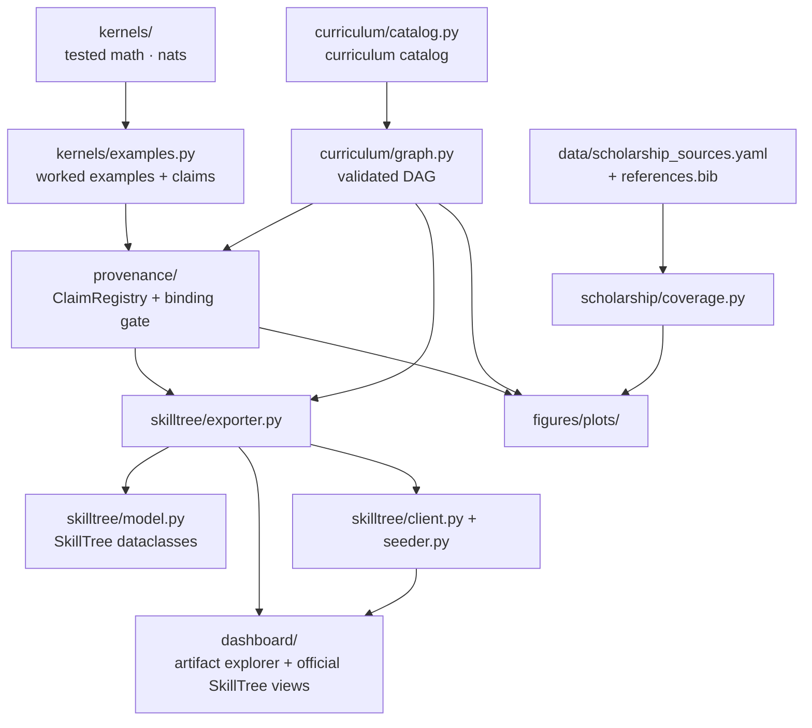

# src/ — Project Logic

All importable logic for Active Skillference lives here. Scripts in `scripts/` are thin
wrappers; these modules compute, validate, and convert. Nothing here re-implements an
algorithm at runtime in a script — the kernels produce every quantitative value, and the
provenance gate guarantees no number reaches a learner without a tested kernel behind it.

## Layout

| Subpackage | Contents |
| --- | --- |
| `kernels/` | Tested computational kernels — the **only** source of quantitative values |
| `provenance/` | The claim registry and the content-provenance binding/lint gate |
| `scholarship/` | Citation source-role coverage, source health, and gap reporting for the manuscript |
| `manuscript/` | Generated figure registry / manuscript / dashboard artifact drift validation, claim support, variables, spelling, web math |
| `curriculum/` | The typed skill model, the prerequisite-DAG engine, the catalog, quality gates, diagnostics, recommendations, and lesson materials |
| `skilltree/` | Curriculum → SkillTree data model, exporter, REST clients, live dependency reconciler, local auth bridge, and seeder |
| `figures/` | Deterministic, data-driven figures and the typed figure registry |
| `dashboard/` | Local learner dashboard shell over generated artifacts and official SkillTree views |
| `pipeline/` | Importable multi-artifact builders (`generated_outputs.py`) that `scripts/run_kernels.py` drives |
| `integration/` | Live Docker + SkillTree + dashboard full-app proof orchestration (`full_app_stack.py`) |
| `artifacts/` | Shared deterministic JSON artifact read/write helpers and audit payload TypedDicts |
| `validation/` | The shared `Finding` base for gate issue dataclasses |
| `pilot/` | Protocol-only learner-pilot contract — privacy and feasibility boundaries, no learner state |
| `project_paths.py` | `resolve_project_root` / `project_output_dirs` path helpers |
| `project_identity.py` | The pinned SkillTree project id and name every producer shares |
| `live_counts.py` | Repository-wide stale generated-count audit for authored surfaces |
| `roadmap.py` | `tasks.yaml` schema/evidence validation and generated roadmap pages |
| `release_readiness.py` | Machine-checked release-isolation inventory |
| `net_guard.py` | HTTP(S)-only and loopback URL guards shared by local-first tools |
| `__init__.py` | Package docstring + `__version__ = "1.0.0"` |

## The subpackages

### `kernels/` — the source of every claim
Pure, deterministic, side-effect-free math in nats:

- `information.py` — `entropy`, `kl_divergence`, `cross_entropy`, `mutual_information`, `surprise`
- `distributions.py` — `softmax`, `normalize`, `log_stable`, `dirichlet_expected`, `dirichlet_expected_log`
- `inference.py` — `bayes_posterior`, `variational_free_energy`, `log_evidence`, `elbo`
- `active_inference.py` — `expected_free_energy`, `policy_posterior`, `DiscreteActiveInferenceAgent`
- `predictive_coding.py` — linear-Gaussian predictive-coding descent (precision-weighted settling to the analytic minimum)
- `examples.py` — worked examples that run the kernels on fixed inputs and `build_claim_registry()` (registers the deterministic claim ledger)

### `provenance/` — the high-integrity gate
- `claims.py` — `Claim` / `ClaimRegistry`: kernels register named claims `{name, value, units, source, description}`; re-registration with a different value or provenance raises; string values may not contain digits.
- `binding.py` — resolve `{{claim:NAME}}` tokens (`render` / `render_graph`), fail closed on unbacked or malformed tokens; `validate_curriculum` / `validate_manuscript_dir` reject dead tokens; `lint_graph` / `find_unbacked_numbers` flag bare decimal result numbers hand-typed into prose.

### `scholarship/` — citation coverage
`coverage.py` — loads `data/scholarship_sources.yaml`, parses authored manuscript
citations, checks them against `manuscript/references.bib`, and writes the deterministic
scholarship audit JSON. This protects source-role coverage separately from numeric claim
provenance. `source_health.py`, `source_health_network.py` and `source_health_report.py`
audit locator syntax, role specificity, and dead-link / bot-block / role-gap /
boundary-source buckets; `frontier_sources.py` and `gap_report.py` separate frontier and
boundary support from genuine source-health issues.

### `manuscript/` — artifact surface validation
`audit.py` — validates `output/figures/figure_registry.json` against the manuscript's
Pandoc figure declarations, `[@fig:...]` cross-references, readable nonblank PNG files,
caption/alt-text specificity, semantic metadata, claim tokens, and dashboard figure
artifacts. It writes
`output/data/manuscript_artifacts.json`, giving the PDF and dashboard a shared audit
surface for generated visuals. `claim_support.py` validates anchored manuscript
scientific claims against declared evidence classes and writes
`output/data/manuscript_claim_support.json`. `variables.py` keeps generated counts bound to
tokens rather than prose literals, `american_english.py` rejects British spellings in
authored prose, and `web_math.py` checks that rendered HTML surfaces carrying math load
MathJax.

### `curriculum/` — the validated DAG
- `model.py` — frozen `Stratum` (8 strata), `Subject`, `Skill`, `Prerequisite` edges, `AssessmentQuestion`.
- `graph.py` — `CurriculumGraph`: `validate()` (acyclic, unique ids, no dangling/self prerequisites, foundational roots only), `topological_order()`, `levels()`, connectivity, and `stats()`.
- `catalog.py` — the entry point; it holds no authored content. The curriculum data lives in `catalog_data/` (canopy plus the `subjects_extensions_*.py` aggregators over the `_ext_*.py` stratum modules), assembled by `catalog_data/assembly.py`. `build_curriculum()` returns the assembled graph after `validate()`, the foundations→applications connectivity check, and `quality.py::validate_curriculum_quality`.
- `diagnostics.py`, `recommendations.py`, `alignment.py` — the diagnostic gap map, next-skill ordering by dependency depth, and the exported-skill/material/quiz alignment check.

### `skilltree/` — the export target
- `model.py` — SkillTree-native dataclasses (`SkillTreeProject`/`SkillTreeSubject`/`SkillTreeSkill`/`SkillDependency`/`Quiz`/`QuizQuestion`); snake_case attributes, camelCase payloads.
- `exporter.py` — `CurriculumGraph` → `SkillTreeProject` (a thin field map); `export_to_json`.
- `summary.py` — shared `ExportSummary` counts plus `validate_export_payload`, the fail-closed check on the serialized project.
- `client.py` — `SkillTreeClient` REST client (`create_project`/`create_subject`/`create_skill`/`assign_dependency`/`create_quiz`/`report_skill`), stdlib `urllib` only; `transport.py` and `admin_ops.py` hold the shared HTTP transport and the canonical, per-segment-quoted REST paths.
- `dependency_reconciler.py` — reconciles the exported prerequisite edges against a live instance with bounded `attempts_per_edge` retries; a timed-out write is resolved by re-reading the live graph, so an edge that landed late is reported as `confirmedAfterTimeout` instead of being lost or double-posted.
- `local_auth.py` / `local_auth_state.py` — local-only SkillTree `FORM` bootstrap, session/XSRF handling, ignored on-disk state, and trusted-client token exchange for the learner dashboard.
- `form_login_core.py` / `form_login_validation.py` — pure login-URL/parse helpers, kept separate from the browser subprocess orchestration that uses them.
- `deployment_matrix.py` — the browser-safe deployment modes the dashboard reports.
- `seeder.py` — `seed`: drives a client to create a project in live-compatible order.

### `figures/` — deterministic visuals
`plots/` — `plot_curriculum_dag`, `plot_dependency_strata_flow`,
`plot_assessment_depth_matrix`, `plot_curriculum_stratum_balance`,
`plot_graph_bottlenecks`, `plot_skill_neighborhood_paths`,
`plot_semantic_prerequisite_coverage`, `plot_free_energy_descent`,
`plot_efe_decomposition`, `plot_planning_lookahead`, `plot_predictive_coding`,
`plot_kernel_sensitivity_profiles`, `plot_vfe_efe_skilltree_bridge`,
`plot_scholarship_coverage`, `plot_open_science_source_map`,
`plot_scholarship_source_health`, `plot_validation_surface_matrix`,
`plot_validation_intent_mismatch_matrix`, `plot_visual_evidence_contract_ladder`,
`plot_scientific_evidence_matrix`, `plot_roadmap_risk`, the front-matter
`plot_active_skillference_cover` / `plot_skill_name_atlas`, and `render_all`.
The figures show the annotated curriculum DAG, dependency-flow, assessment-depth and
stratum-balance matrices, graph bottlenecks and prerequisite paths, a VFE belief sweep,
an EFE sample/commit precision sweep, planning look-ahead and predictive-coding descent,
a SkillTree bridge for supplement subjects and routes, kernel sensitivity profiles,
citation-lane, open-science and source-health coverage, scientific evidence coverage,
roadmap risk, and validation surface coverage.
`registry.py` loads the typed figure registry/chart contract and `registry_manifest.py`
holds the canonical rows and semantic overrides; `table_companions.py` builds the table
companions for dense figure cards.
Numeric inputs come from the `ClaimRegistry` or the `CurriculumGraph`; scholarship inputs
come from the validated source audit; claim-support inputs come from the manuscript
support audit. `render_all` also writes `figure_registry.json` for the manuscript artifact
validator. Headless `Agg` backend.

### `dashboard/` — local learner shell
`config.py`, `status.py`, `payload.py`, `artifacts.py`, `artifact_catalog.py`,
`figure_metadata.py`, `graph_analysis.py`, `live_validation.py`, and `server.py` serve a
dependency-free local dashboard. It reads generated `output/data/*.json` files, exposes
artifact links, checks SkillTree's public status endpoint, and mounts the official
SkillTree client display through the local trusted-client bridge when bootstrapped. It
stores only local runtime credentials under the ignored state directory; progress,
ranking, quiz state, and learner records remain SkillTree-owned.

Three browser-facing contracts live in `server.py` and `payload.py`:

- The page **Content-Security-Policy** starts at `default-src 'none'` and then names the
  SkillTree origin in `frame-src` and its `ws://`/`wss://` origin in `connect-src`. The
  official `skills-client-js` display is an iframe on that origin with a SockJS socket back
  to it, and the browser matches the socket against the WebSocket scheme rather than the
  configured `http:` origin, so both directives are load-bearing.
- **`/api/status?defer_live=1`** skips only the live parity round trip for first paint;
  `deferred_live_skilltree_summary` returns an explicit `checked: false, deferred: true`
  block with the expected edge count, so a deferred answer never reads as a passed check.
  Validators use the default, non-deferred path.
- **JSON responses are gzip-encoded** above a size threshold when the client advertises
  `gzip`, with `Vary: Accept-Encoding`. The decoded bytes are unchanged, so payload
  contracts are unaffected.

## Quick Start

```python
from src.curriculum.catalog import build_curriculum
from src.kernels.examples import build_claim_registry
from src.provenance.binding import validate_curriculum, render_graph
from src.skilltree import export_project

graph = build_curriculum()  # validated prerequisite DAG
registry = build_claim_registry()  # runs the kernels, registers claims
validate_curriculum(graph.skills, registry)  # fail closed on any unbacked token
rendered = render_graph(graph, registry)  # substitute every {{claim:NAME}}
project = export_project(rendered, "activeInference", "Active Inference & the FEP")
print(len(project.subjects), "subjects;", len(rendered.skills), "skills")
```

## Run Tests

From the project root:

```bash
uv run pytest --cov=src --cov-fail-under=90    # all tests, ≥90% src coverage
```

## Architecture



## More Information

See [`AGENTS.md`](AGENTS.md) for the agent guide and module API, and [`STYLE.md`](STYLE.md)
for code-style conventions.
