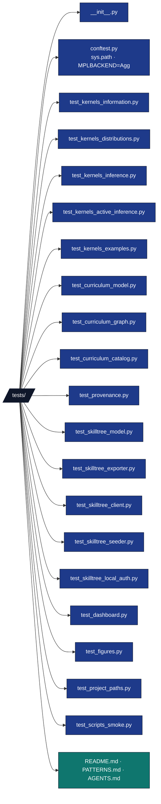

# tests/ - Agent Guide

## Overview

`tests/` validates Active Skillference end to end: the computational **kernels** (the source
of every learner-facing number), the prerequisite-**DAG** engine, the **provenance** gate,
and the **SkillTree** export/seed path. All tests use real computation — no mocks. The one
network boundary (the SkillTree REST client and seeder) is tested against a real local
server via `pytest-httpserver`. Imports use the `src.*` namespace.

## Key rules

- **Zero mocks**: no `unittest.mock`, `MagicMock`, or `@patch`. Real numpy arrays, real temp
  files, real generated artifacts.
- **`src.*` import discipline**: import as `from src.kernels.information import entropy`.
  `conftest.py` puts `src/` (and the repo root) on `sys.path` and sets `MPLBACKEND=Agg`.
- **REST via `pytest-httpserver`**: the SkillTree client/seeder tests stand up a real local
  HTTP server and assert the exact path, method, bearer header, and body.
- **Determinism**: fixed inputs preferred; seed any RNG; the registry and JSON export are
  byte-deterministic.
- **`requires_browser` marker**: opt-in tests that exercise `chrome-devtools-axi` /
  browser subprocess paths (for example `test_skilltree_form_login.py::
  test_browser_command_failures_are_redacted`). Default runs skip them with
  `pytest -m "not requires_browser"`; run browser-only with `pytest -m requires_browser`.
- **Dashboard design contract**: `tests/test_dashboard_design.py` guards the root
  `DESIGN.md` contract and rejects raw dashboard CSS colors outside the declared token
  block.

## Directory Structure

A representative slice of the suite — the full file-by-file table lives in
[`../docs/testing_philosophy.md`](../docs/testing_philosophy.md), and `ls tests/` is the
authoritative list.



## Coverage facts

- Enforced gate floor: **90%** (`--cov-fail-under=90`).
- Use the coverage command output as the source of truth for current test count and
  percentage. Do not restate a number here — it goes stale silently.
- `kernels/` is held well above the floor; a kernel change lands with a real-value test
  asserting an analytic result, not a smoke call. Check the per-file number with
  `uv run coverage report --include='src/kernels/*'` after running the suite.

## Run commands

```bash
# From the project root
uv run pytest tests/                # full suite
uv run pytest tests/ -v             # verbose
uv run pytest tests/ --cov=src --cov-fail-under=90   # enforced coverage gate

# Run one file
uv run pytest tests/test_provenance.py -v

# Run a single test
uv run pytest tests/test_kernels_information.py::TestEntropy::test_uniform_distribution_matches_log_cardinality -v
```

## Test inventory

Grouped highlights, not the complete list; see
[`../docs/testing_philosophy.md`](../docs/testing_philosophy.md) for every file.

### Kernels (the source of every claim)

- `test_kernels_information.py` — `TestSurprise`, `TestEntropy`, `TestCrossEntropyAndKl`,
  `TestMutualInformation`, `TestProbabilityVectorGuards`. Asserts identities such as
  `H(uniform_n)=ln n`, `KL(p‖p)=0`, `KL≥0`, `H(p,q)=H(p)+KL(p‖q)`, and input guards.
- `test_kernels_distributions.py` — `TestNormalize`, `TestSoftmax`, `TestLogStable`,
  `TestDirichletHelpers`.
- `test_kernels_inference.py` — `TestBayesPosterior`, `TestVariationalBounds`,
  `TestModelInputGuards` (rejects negative likelihood and unnormalized columns).
- `test_kernels_active_inference.py` — `TestExpectedFreeEnergy`, `TestPolicyPosterior`,
  `TestDiscreteActiveInferenceAgent`, plus tests showing the epistemic preference is
  **regime-dependent**, not a universal law.
- `test_kernels_examples.py` — the claim registry: each entropy/free-energy/Bayes/softmax
  claim matches its analytic value, the registry is deterministic, and every catalog claim
  token resolves.
- `test_kernels_predictive_coding.py` — precision-weighted posterior settling, monotone
  free-energy descent, and agreement with the analytic minimum.

### Curriculum

- `test_curriculum_model.py` — `Stratum`/`Skill`/`Subject`/`AssessmentQuestion` validation
  (eight strata in order, only the first two foundational, id/field/points guards,
  single-correct assessments, stratum-mismatch rejection).
- `test_curriculum_graph.py` — DAG engine: cycle / dangling / self-loop / non-foundational
  root all raise `CurriculumError`; topological order and levels respect prerequisites;
  `is_connected_foundations_to_applications()` is fail-closed.
- `test_curriculum_catalog.py` — the Active Inference catalog builds and validates,
  enumerates the configured catalog floor, all eight strata present, foundations connected to
  applications, roots only in foundational strata, ids unique.

### Provenance

- `test_provenance.py` — `ClaimRegistry` (register/get/conflict/JSON round-trip),
  `{{claim:NAME}}` `render`/`render_graph` (substitution + fail-closed on unbacked/empty
  tokens across **all** learner-facing fields), the bare-number linter (`find_unbacked_numbers`,
  `lint_curriculum`, `lint_graph`), and manuscript-token validation
  (`validate_manuscript_dir` catches dead tokens; guards the shipped manuscript).

### SkillTree export / REST

- `test_skilltree_model.py` — schema dataclasses, camelCase export dicts, id and field
  validation (rejects slashes, leading underscores, adversarial ids; self-loop dependency).
- `test_skilltree_exporter.py` — curriculum→SkillTree projection: subject/skill/dependency
  counts, edge direction, quiz building, verbatim descriptions, deterministic sorted JSON.
- `test_skilltree_client.py` — REST client against `pytest-httpserver`: admin/api paths,
  bearer token, request body, and non-2xx → `SkillTreeClientError` mapping.
- `test_skilltree_seeder.py` — `seed()` against a real local server, asserting the exact
  call ordering (quizzes before quiz-gated skills, dependencies after skills).
- `test_skilltree_local_auth.py` — local `FORM` bootstrap state, session/XSRF admin flow,
  trusted-client token exchange, and secret redaction.
- `test_form_login_core.py` — pure helpers in `form_login_core.py` (no browser subprocess).
- `test_skilltree_form_login.py` — thin-script re-exports plus browser-command redaction
  (`@pytest.mark.requires_browser` on subprocess-path tests).
- `test_dependency_reconciler.py` — live edge reconciliation against a real local server:
  bounded `attempts_per_edge` retries and post-timeout authoritative confirmation, so a
  write that landed late is counted as confirmed rather than re-posted.
- `test_scholarship.py` — citation source-role matrix validation, planted failure cases,
  real manuscript coverage, and deterministic audit JSON.

### Dashboard and live stack

- `test_dashboard.py` — dashboard payloads, artifact inventory, official SkillTree display
  configuration, the local Learn / Open Subject / Quiz split, and fallback behavior.
- `test_dashboard_server.py` — the HTTP surface: host/origin guards, token endpoint, CORS,
  the page CSP (SkillTree origin in `frame-src`, its `ws://` origin in `connect-src`),
  `?defer_live=1` dropping only the parity round trip, and gzip negotiation that leaves the
  decoded body byte-identical.
- `test_dashboard_console.py` / `test_dashboard_live_validation.py` — browser-console
  classification and live payload validation against a real `pytest-httpserver` SkillTree.
- `test_full_app_stack.py` — live-stack orchestration helpers, including the browser-session
  probe that restarts a stale automation daemon once before a browser proof.

### Figures, paths, scripts

- `test_figures.py` — `plots/` renders the DAG, scholarship coverage, free-energy
  descent, and EFE-decomposition figures to non-empty PNGs under the headless Agg backend.
- `test_project_paths.py` — output-dir keys and project-root resolution helpers.
- `test_scripts_smoke.py` — `build_curriculum.py`, `analyze_scholarship.py`,
  `run_kernels.py`, and `export_skilltree.py` run to exit 0; `run_kernels.py` emits
  `output/data/claims.json` and `output/data/scholarship_coverage.json`, and
  `export_skilltree.py` emits a `skilltree_project.json` with all `{{claim:…}}` tokens
  resolved.

## See Also

- [README.md](README.md) — quick reference and file inventory
- [PATTERNS.md](PATTERNS.md) — conventions with real code examples
- [../src/kernels/active_inference.py](../src/kernels/active_inference.py) — active-inference agent under test
- [../src/curriculum/graph.py](../src/curriculum/graph.py) — DAG engine under test
- [../src/skilltree/client.py](../src/skilltree/client.py) — REST client under test
- [../src/scholarship/coverage.py](../src/scholarship/coverage.py) — scholarship audit under test
- [../scripts/analyze_scholarship.py](../scripts/analyze_scholarship.py) — emits the scholarship audit JSON and figure
- [../scripts/run_kernels.py](../scripts/run_kernels.py) — emits the provenance ledger and scholarship audit
