# tests/ - Zero-Mock Test Suite

An uncompromising validation layer for Active Skillference's computational kernels,
prerequisite-DAG engine, provenance gate, and the SkillTree export/seed path. Enforces a
strict Zero-Mock policy: every test exercises real computation, and the single REST
boundary is tested against a real local server with concrete request handlers.

## Quick Start

```bash
# From the project root
uv run pytest tests/ -v
uv run pytest tests/ --cov=src --cov-fail-under=90
```

Tests import from the `src.*` namespace (`pythonpath = [".", "src"]`); `conftest.py` also
puts `src/` on `sys.path` and forces `MPLBACKEND=Agg` so figure tests run headless.

## Coverage facts

- The authoritative command is `uv run pytest tests/ --cov=src --cov-fail-under=90`.
- `src/` line coverage must stay at or above the **90%** gate.
- The `kernels/` package — the source of every learner-facing number — should remain fully covered.
- **Zero mocks.** Real numeric computation everywhere; `pytest-httpserver` provides a real
  local HTTP server for SkillTree REST boundaries.

## Test Files

| File | Covers |
| --- | --- |
| `test_kernels_information.py` | `kernels/information.py` — surprise, entropy, cross-entropy, KL, mutual information, and their algebraic identities and guards |
| `test_kernels_distributions.py` | `kernels/distributions.py` — `normalize`, `softmax`, log-stable helpers, Dirichlet helpers |
| `test_kernels_inference.py` | `kernels/inference.py` — Bayes posterior, variational free-energy bound, model-input guards |
| `test_kernels_active_inference.py` | `kernels/active_inference.py` — expected free energy, policy posterior, the discrete active-inference agent (including the regime-dependent epistemic-preference behavior) |
| `test_kernels_examples.py` | `kernels/examples.py` — the claim registry; checks each claim matches its analytic value and that catalog claim tokens all resolve |
| `test_curriculum_model.py` | `curriculum/model.py` — `Stratum`, `Skill`, `Subject`, `AssessmentQuestion` typed-model validation |
| `test_curriculum_graph.py` | `curriculum/graph.py` — DAG validation (cycles, dangling/self-prereqs, foundational roots), topological order, levels, foundations→applications connectivity |
| `test_curriculum_catalog.py` | `curriculum/catalog.py` — the Active Inference catalog builds, validates, and enforces the current catalog floors across all eight strata |
| `test_provenance.py` | `provenance/claims.py` + `provenance/binding.py` — claim registry round-trip, `{{claim:NAME}}` render/resolve, fail-closed export, the bare-number linter, and manuscript-token validation |
| `test_scholarship.py` | `scholarship/coverage.py` and source health — citation source-role matrix validation, stale matrix/BibTeX rejection, online-timeout status handling, real manuscript coverage, and audit JSON |
| `test_claim_support.py` | `manuscript/claim_support.py` — claim-support anchors, evidence-class requirements, real manuscript support, and unsupported strong scientific language |
| `test_manuscript_language.py` | `manuscript/american_english.py` — American English spelling validation for authored manuscript prose, including negative controls for British spelling variants |
| `test_manuscript_artifacts.py` | `manuscript/audit.py` — figure registry, manuscript label/cross-reference, PNG readability/information content, caption/alt text, semantic metadata, claim tokens, and dashboard artifact drift validation |
| `test_skilltree_model.py` | `skilltree/model.py` — SkillTree schema dataclasses, camelCase export dicts, id/field validation |
| `test_skilltree_exporter.py` | `skilltree/exporter.py` — curriculum→SkillTree projection, edge direction, quiz building, deterministic JSON |
| `test_skilltree_client.py` | `skilltree/client.py` — REST client against a real `pytest-httpserver` (path/method/bearer/body, error mapping) |
| `test_skilltree_seeder.py` | `skilltree/seeder.py` — end-to-end seeding ordering against a real local server |
| `test_skilltree_local_auth.py` | `skilltree/local_auth.py` — local bootstrap state, session/XSRF admin flow, trusted-client token exchange, secret redaction |
| `test_dashboard.py` | `dashboard/` — config/status/artifact routes, official SkillTree display configuration, local token endpoint, fallback behavior |
| `test_figures.py` | `figures/plots/` — deterministic DAG, scholarship, evidence matrix, sensitivity, free-energy, and EFE figures render to non-empty PNGs |
| `test_project_paths.py` | `project_paths.py` — output-dir resolution and project-root helpers |
| `test_scripts_smoke.py` | the thin orchestrator scripts (`build_curriculum.py`, `analyze_scholarship.py`, `run_kernels.py`, `export_skilltree.py`, live dashboard validator) run to exit 0 and emit or validate their artifacts |

## Architecture

```mermaid
graph TD
    KI[test_kernels_information.py] --> SKI[src/kernels/information.py]
    KD[test_kernels_distributions.py] --> SKD[src/kernels/distributions.py]
    KIN[test_kernels_inference.py] --> SKIN[src/kernels/inference.py]
    KAI[test_kernels_active_inference.py] --> SKAI[src/kernels/active_inference.py]
    KE[test_kernels_examples.py] --> SKE[src/kernels/examples.py]
    CM[test_curriculum_model.py] --> SCM[src/curriculum/model.py]
    CG[test_curriculum_graph.py] --> SCG[src/curriculum/graph.py]
    CC[test_curriculum_catalog.py] --> SCC[src/curriculum/catalog.py]
    PROV[test_provenance.py] --> SPB[src/provenance/binding.py]
    PROV --> SPC[src/provenance/claims.py]
    SCH[test_scholarship.py] --> SSCH[src/scholarship/coverage.py]
    MSA[test_manuscript_artifacts.py] --> SMA[src/manuscript/audit.py]
    STM[test_skilltree_model.py] --> SSM[src/skilltree/model.py]
    STE[test_skilltree_exporter.py] --> SSE[src/skilltree/exporter.py]
    STC[test_skilltree_client.py] -->|pytest-httpserver| SSC[src/skilltree/client.py]
    STS[test_skilltree_seeder.py] -->|pytest-httpserver| SSS[src/skilltree/seeder.py]
    SLA[test_skilltree_local_auth.py] -->|pytest-httpserver| SLA_SRC[src/skilltree/local_auth.py]
    DASH[test_dashboard.py] --> SDASH[src/dashboard]
    FIG[test_figures.py] --> SF[src/figures/plots/]
    PP[test_project_paths.py] --> SPP[src/project_paths.py]
    SMK[test_scripts_smoke.py] --> SCRIPTS[scripts/ orchestrators]
```



> **Zero-Mock Policy**: Tests use real numpy arrays, real temp files, generated artifacts,
> and a real local HTTP server. No `unittest.mock`, `MagicMock`, or `@patch`. The only
> network boundary — the SkillTree REST client and seeder — is tested with
> `pytest-httpserver`, asserting the actual request path, method, headers, and body.

## More Information

See [AGENTS.md](AGENTS.md) for the agent guide and run/coverage commands, and
[PATTERNS.md](PATTERNS.md) for the testing conventions with real examples.
